# Little Raft

A small original 3D cooperative raft survival sandbox. Hook supplies, extend the raft, craft decorations and automatic collection nets, fish, grow palms, and keep an eye on the shark.

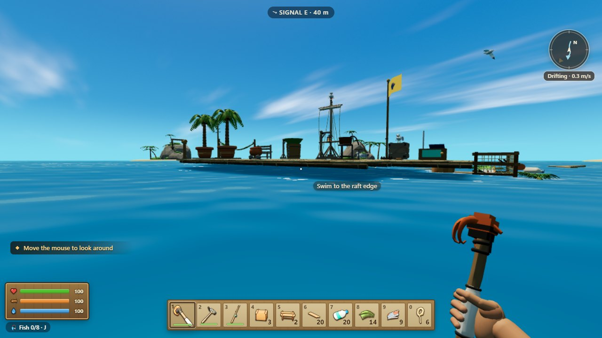

## A look around

You start on four planks with nothing but a hook. Throw it, reel in whatever drifts past, and the raft grows from there.

| | |
|---|---|
| 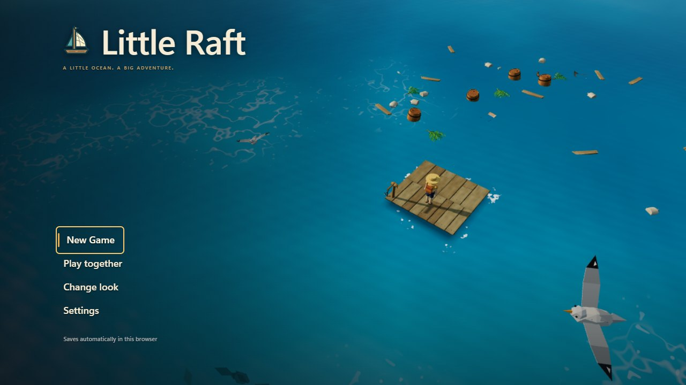 | 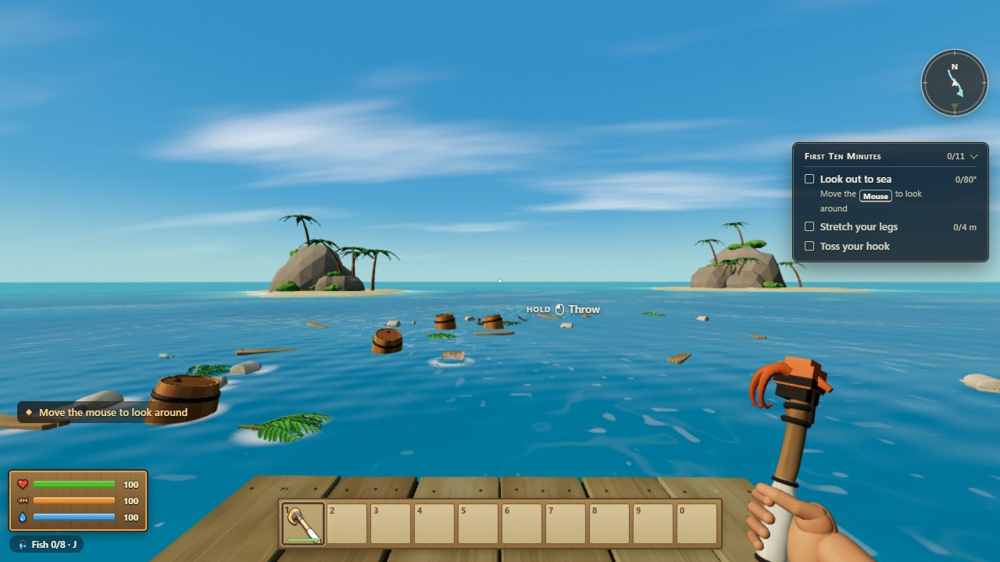 |
| The title screen floats over a live ocean. | A fresh game: one hook, open water, supplies drifting by. |

### Hooking supplies

Hold to charge, release to throw, hold again to reel. Every catch lands in the pickup feed in the bottom-left corner.

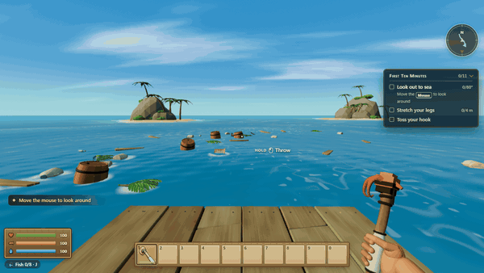

### Crafting and the bag

| | |
|---|---|
| 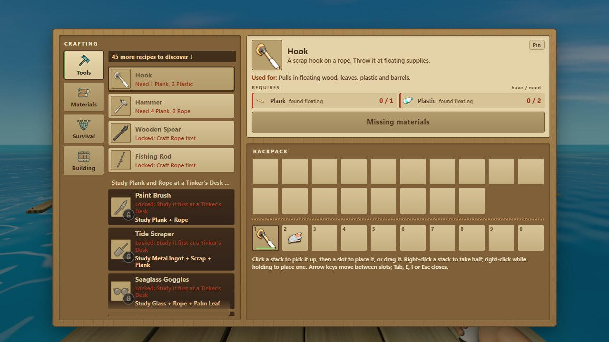 | 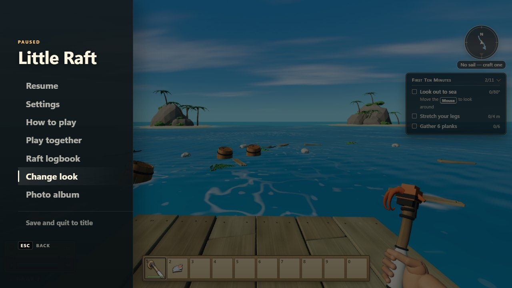 |
| Tab opens the bag and the recipe book. Locked recipes show what to study first. | Escape pauses. Settings, co-op, your look and the photo album live here. |

### Building

Pick up the hammer to extend the floor, or hold any decoration to place it freely with a pointing finger.

| | |
|---|---|
| 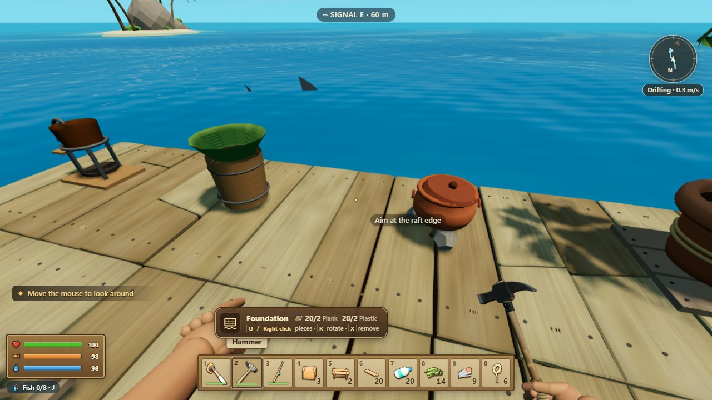 | 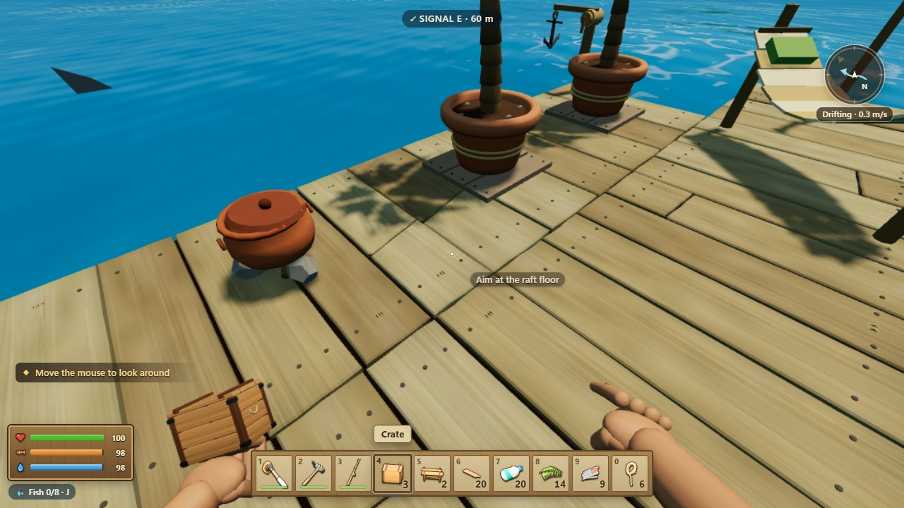 |
| The hammer shows the foundation cost and where it fits. Note the fin in the water. | Decorations do not snap to the grid. |

### Life on deck

Palms in planters, a purifier, a rain barrel, a cooking pot, a hammock, lanterns, a sail and a signal receiver, all on one raft.

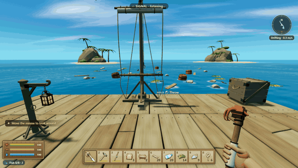

### Day, night and weather

The sun sets, lanterns matter, and rain rolls in now and then.

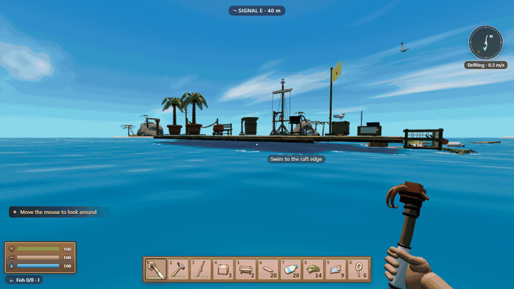

| | |
|---|---|
| 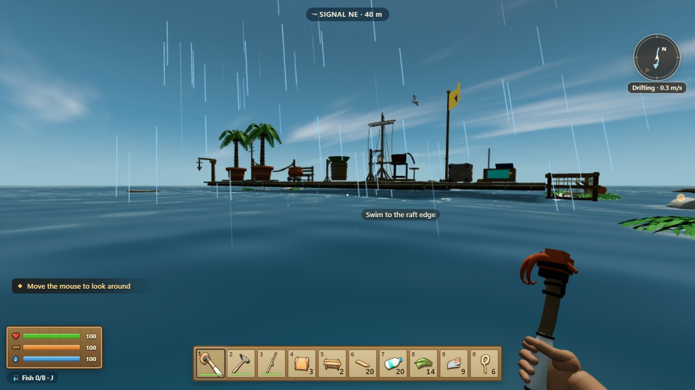 | 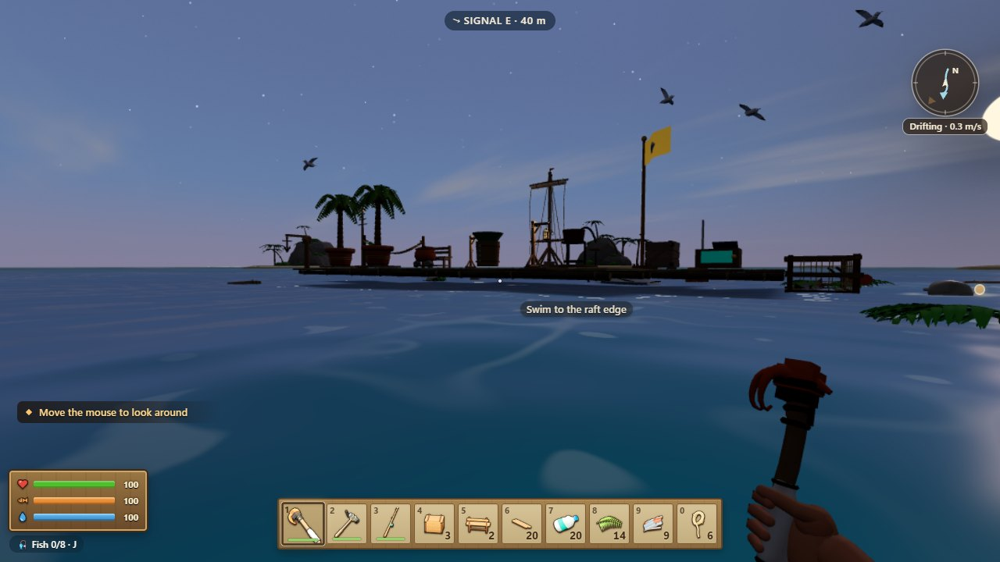 |
| Rain fills the rain barrels. | Night on open water. |

Every shot above is a real capture of the game from `dist/`, taken with [tools/shoot_readme.py](tools/shoot_readme.py).

## Running it

Run `python -m http.server 8766 --directory dist`, then open http://localhost:8766. Serve over HTTPS for remote play. Built with Three.js 0.170.0 and PeerJS 1.5.4, vendored under `dist/vendor`. Their upstream MIT licenses apply. Google Fonts are optional; system fonts are the fallback.

## Playing together

Open the same hosted game on both computers. One player chooses Play together → Host our raft and shares the six-letter code. The second chooses Join raft. The host keeps the app open. The raft and floating supplies are shared; each player has a personal inventory, character and camera. The host saves the raft and both bags. Guest worlds do not overwrite the guest's own save.

Online play uses PeerJS's public signaling broker and browser WebRTC data channels. Some networks require a TURN relay, which this small prototype does not provide. Errors and connection timeouts are shown in the room dialog. No chat, microphone, or camera access is used. This is a cooperative prototype for trusted players, without server-side anti-cheat.

## Controls

- Hold left mouse to charge, release to throw, then hold left mouse to reel.
- WASD / arrows: walk in first person; mouse: look.
- 1–8 / mouse wheel: select a real hotbar slot.
- Tab / I: inventory and crafting. E: pick up a nearby supply or open inventory.
- Space: jump; Shift: run. You can fall into the water; hold Space near the edge to climb aboard.
- Craft a hammer to build foundations (2 wood + 2 plastic); craft decorations before placing them.
- Craft a fishing rod, then click water and wait for a catch.
- L: open the raft logbook (message-bottle notes and achievements).
- Purifier: scoop sea water with a cup, pour it into a purifier, take fresh water and water palm planters; harvest ripe palms with E.
- Receiver: place one with up to 3 antennas (2+ tiles away) to detect drifting signal caches; follow the SIGNAL readout and hook the buoy.
- Escape: release the cursor and open settings; Resume returns to play.

Supplies regenerate indefinitely. Nets automatically gather nearby supplies into the host's bag. Resources stack to 20. A fresh game starts with one hook and no free supplies or tools. Earned legacy supplies are migrated into stacks. No paid services or keys are required to play solo.

## Desktop and live releases

Windows starts with `python desktop/launch.py` or the Little Raft desktop shortcut. The launcher serves the live `dist/` folder on port 41896 and opens the Electron app. The Mac app connects to the same Windows LAN server. Windows must remain awake and reachable for the Mac to load updates.

Active apps poll `/version.json` every six seconds. A changed compatible build stages its JavaScript and CSS, captures the current world and connection, then swaps engines without navigating the page. Failed mounts keep the previous engine. Desktop shell updates and incompatible network protocol changes require a later restart.

Worker checkouts under `.team/` and QA builds under `.qa/` are separate from the live feed. Publish an already tested candidate with `python publish_local.py <candidate-dist> --label <release>`. The publisher writes the manifest last; the server uses `RAFT_RELEASE_MODE=1` to advertise only committed releases. `check_live_feed.py` exercises a real automatic publication with two connected headless clients and checks connection, supplies, and raft preservation.

The release watcher starts with the Windows launcher and also runs as `python release_queue.py --watch`. It serves an isolated candidate, runs every configured check, rejects failures, and publishes passing snapshots automatically. See [release_queue_README.md](release_queue_README.md) for queue/status details. `enqueue_release.py` snapshots a candidate and marks it ready; worker output is integrated before being queued.

The published v3 release includes hook-only spawning, personal inventory stacks, crafting, jumping/swimming, and ballistic multicatch. The release gate runs 22 module tests, settings checks, real-input survival checks, and a connected v2-to-v3 rolling upgrade. The upgrade test confirms earned supplies, room connection, movement, and guest save restoration without navigation.
