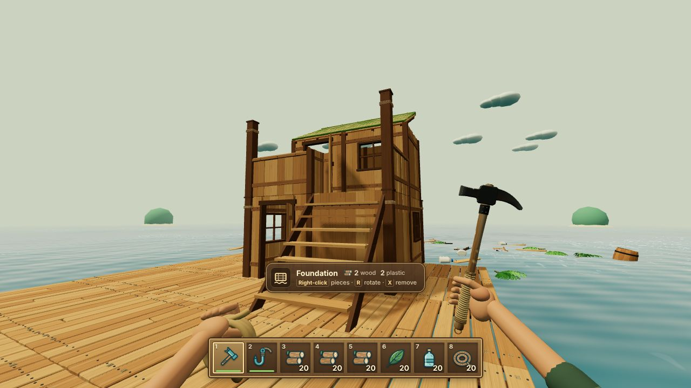

# Building pieces lane

Raft-style multi-storey building with the hammer. You can place floors, walls, half walls, windows, doors, pillars, stairs and roofs. Pieces snap to the raft grid. A green or red ghost shows the spot, R rotates, and holding then releasing X removes a piece. Removal gives back the full cost (friendly). Pieces save and load, and sync in co-op. All art is original and procedural, in the same wood style as `deck.js`.

## Controls (hammer in hand)
| Input | Action |
|---|---|
| Hold **right mouse** (or tap **Q**) | Opens the build wheel. Move the mouse toward a piece, then release or click to pick it. Esc, or losing pointer lock, cancels. |
| **Left click** | Place the ghost if it is green. **Foundation** keeps the old flow: a new 2x2 tile beside the raft. |
| **R** | Rotate stairs and roofs. The default faces away from the player. R still repairs the hook when Foundation is selected. |
| Hold **X**, release | Remove the piece shown in red. It is refused if something rests on it. |

## Files (all new)
| File | What |
|---|---|
| `dist/building-pieces.js` | Pure module, no DOM and no THREE. It holds the piece data (`PIECES`, `PIECE_ORDER`, costs), the grid and keys, and the snapping and support rules (`BuildGrid.canPlace/place/canRemove/remove/load`). It also does aiming (`aim()` picks the nearest valid slot to the crosshair ray; `pick()` handles removal), collision (`preStep`/`postStep` around `PlayerPhysics.update`), and `cleanPieces` for save and network data. Hot paths make no per-frame allocations. |
| `dist/building-models.js` | Procedural geometry for each piece type. Each type is one merged geometry with vertex colours plus one shared wood material (`createPieceGeometry`, `createPieceMaterial`). |
| `dist/build-menu.js` | Radial wheel and HUD chip. It shows the piece, its cost (red when you can't afford it), hints, and the reason a ghost is red. DOM only. |
| `dist/building.js` | Glue. It draws one `InstancedMesh` per piece type in a group that follows the raft, and handles the ghost, input, and host-authoritative `apply()` (charge or refund on the actor's bag). |
| `tests/building-pieces.test.mjs` | Rules, load sanitising, aim and pick, and basic walking. |
| `tests/building-physics.test.mjs` | Movement fuzzing with the real `PlayerPhysics` at dt 1/60 and 1/20, with the deck bobbing. Covers stairs in all 4 directions, doors, walls, corners, ledges, head bonks, and clambering past walls. |
| `scripts/shoot-building.py` | Seeds a 2-storey house, then plays it headless: places, removes and walks up the stairs. It saves the shots below. |

### Grid
- `LEVEL_H = 2.2`.
- Cell `(i,j)` is the existing 2x2 tile.
- Edge `(i,j,a)`: `a=0` is the cell's −z side and `a=1` is its −x side.
- Corner `(i,j)` is the cell's (−x,−z) corner.
- A saved record is `{t,i,j,l,r}`.

### Support rules
- **Pillars** stand on a tile (level 0) or on a pillar or floor below.
- **Walls** stand on a tile or floor, or on a full-height wall below.
- **Floors and roofs** need a full-height wall or pillar under one of their edges or corners, or stairs landing in them. They may also overhang one cell from a supported floor.
- **Stairs** need a floor or tile under them and no floor above.

### Costs
| Piece | Cost |
|---|---|
| floor | 2 wood |
| wall | 2 wood |
| half wall | 1 wood |
| window | 2 wood |
| door | 3 wood |
| pillar | 1 wood |
| stairs | 3 wood |
| roof | 1 wood + 2 leaf |

## Hooks in existing files
Every hook in `dist/game.js` is a single line or a tiny block tagged `// building-pieces lane hook`. Run `grep -n "building-pieces lane hook" dist/game.js` to list them.
- **Import:** `createBuilding`, `cleanPieces`.
- **World and save:**
  - `newWorld` gets `pieces:[]`.
  - `cleanWorld` gets `pieces:cleanPieces(v.pieces, tiles)`.
  - `copyWorld` copies the pieces.
- **Scene:**
  - `init` creates `building`.
  - `rebuildRaft` ends with `building.sync(world)`.
  - `disposeScene` disposes it.
- **Movement:** `movePlayer` wraps `physics.update` with `building.preStep` (surface height and support cells) and `building.postStep` (walls, ceilings and ramps).
- **Aim:**
  - `useSelected`: a hammer with a non-foundation piece selected sends the `{kind:'piece'}` action.
  - `updateGhost` calls `building.update(...)` every frame and hides the old floor ghost.
- **Actions:** `applyAction` handles `piece` and `unpiece` through `building.apply(a, bag, world)`. The host is authoritative, and the guest's own bag pays.
- **Network:**
  - `hostState` sends `pieces` only when the array changes; `sentPieces` resets when a guest connects.
  - The guest keeps its pieces when they are omitted, and only re-syncs the pieces (not the whole deck) when they change.
- **Input:**
  - Right-button down and up open and close the wheel.
  - Mousemove goes to the wheel while it is open.
  - Keydown passes R, Q, X and Esc to `building.key`; keyup X removes.
  - Pointer-lock loss cancels the wheel.
- **Debug:** `raftDebug.state.pieces = {list, piece, rotation, removing}`.

The only other existing file changed is `package.json`: `npm test` now also runs the two new test files.

## Tests
`npm test` passes: 53 tests, 0 failures. That covers 22 survival tests, 16 rules/aim tests and 15 movement-fuzz tests. Headless QA (`python3 scripts/shoot-building.py`) checks the following:
- All 30 seeded pieces load.
- The wheel picks a piece.
- Placing a wall takes 2 wood, and removing it with X refunds 2 wood.
- A spot over water shows "Needs support below".
- Walking up the stairs ends grounded on the upper floor (eye 4.0).
- There are no page errors.

## Screenshots (`shots/building-pieces/`)
| Shot | Shows |
|---|---|
| `01-exterior-corner`, `01b-exterior-left` | The seeded 2-storey house: stairs, balcony railing and thatch roofs. |
| `02-ghost-valid-wall`, `02b-ghost-invalid-wall`, `02c-wall-placed` | Green and red ghosts, and a placed wall. |
| `03-radial-wheel` | The build wheel. |
| `04-upper-floor-room`, `04b-upper-floor-view`, `04c-balcony-side` | The player after climbing the stairs. |
| `05-door-from-deck`, `05b-through-door`, `05c-interior` | The door and the interior. |
| `06-remove-highlight` | The X removal highlight. |
| `07-corner-joint` | A pillar and wall joint close-up. |
| `08-stairs-side` | The stairs from the side. |

## Known limits and follow-ups
- **Physics:** `PlayerPhysics` knows one deck height per frame, so ramps lag one frame. Lag spikes make this about 0.2 m.
  - Clambering out of the water only reaches deck height.
  - The clamber check against walls reads the private `_climb` fields. The new tests catch it if they are renamed.
- **Collision gaps:**
  - The open door leaf is decorative and has no collision.
  - A grounded player can step over box tops within 0.55 m, which is needed for walls under the stairs' top edge. So you can step over a railing from partway up the stairs.
- **Input:** with a non-foundation piece selected, R rotates instead of repairing the hook.
- **Build limits:** no foundation removal, no ladders, a cap of 600 pieces, and every roof instance looks the same.
- **Co-op:** the guest has no local prediction, so its pieces appear when the next host state arrives (about 0.12 s).
- **QA speed:** a debug `teleport()` in `raftDebug` would make headless QA much faster than walking (currently about 12 min).
