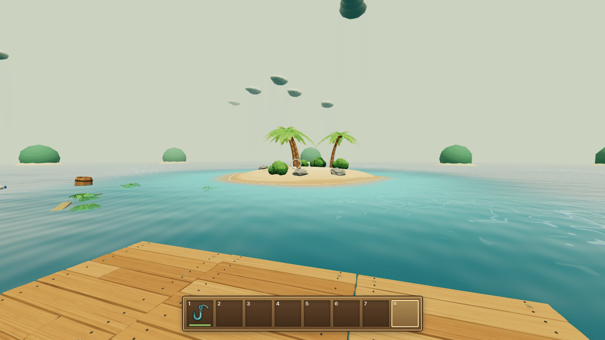
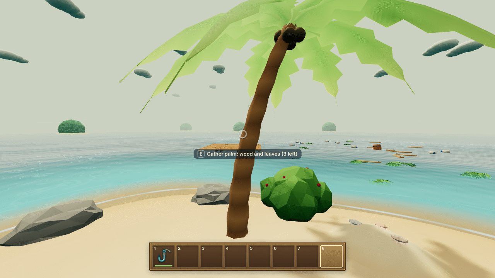
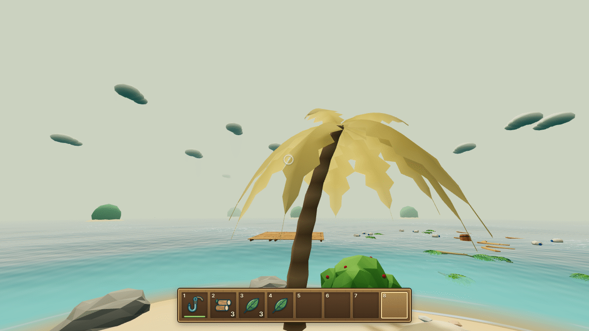

# Islands

Small islands drift past the raft every few minutes. You swim over, walk on the sand, gather
from palms, bushes, rocks and sand patches by tapping E, and swim back before the island drifts
off. Nothing hurts you, and nobody gets stranded.

This revision targets the content registry (`dist/content.js`, `docs/features/content-hooks.md`).
Everything lives in `dist/islands.js` (plus an optional `dist/islands-layout.js` for pure logic)
and needs **no game.js edits**.

## As built

Built on `claude/raft-content-islands`. No shared files were touched: game.js, content.js and
inventory-state.js are unchanged, and no new hook was needed.

| File | What it holds |
| --- | --- |
| `dist/islands.js` | `createIslands(ctx)`: timeline, placement, stand on sand, E to gather, save/sync, debug. Re-exports the pure helpers. |
| `dist/islands-layout.js` | Pure logic with no THREE: `layoutFor`, `pathAt`, `clean`, `lootFor`, `groundHeight`, `nextDelay`, `dockOffset`, `applyGather`, `standOnSand`. |
| `dist/islands-models.js` | Cached geometries and materials, built once per game. |
| `tests/islands.test.mjs` | 31 tests: layout, timeline, save validation, loot and host rules, stand on sand with the real `PlayerPhysics` and the real ocean waves, departure, guest clock slew, the ray pick, and a stub-ctx run of the module. |





**What changed from the plan below, and why:**

- **The dome profile is flatter.** The planned `TOP - (TOP+DROP)·u²` left only about 2.5 m of
  walkable sand. Built: `TOP - FALL·u⁴`, with `TOP = 0.9` and `FALL = 1.8`, times a gentle
  shoreline wobble `shape(θ)`, rotated per seed. Low dunes (`heightU`, up to about 0.15 m, faded
  out by `(1-u²)³` before the shore) break up the flat top; the dome mesh and the physics share
  the same function, so feet stay on the sand you see. The shore is at `u ≈ 0.84`, the walkable top
  reaches about `0.69 R`, R is 6 to 9 m, and the mesh ends at `u = 1.15`. All nodes sit within
  `0.7 R`, on dry sand.
- **Shallow water is a lagoon overlay, not a sunken disc.** The ocean shader is opaque, so nothing
  under it shows. The lagoon is a ring mesh that reuses the ocean's own vertex shader (shared
  `uTime`), so it rides the same waves 10 cm above them (at 5 cm the coarser ocean grid poked through near the camera as a grey band). It has a small fragment shader: wet sand
  near the shore fades to turquoise and then teal, the alpha fades out by about 2.4 R, and there is
  a wobbling foam line plus foam rings rolling in. It shares `uSky` and the fade uniforms with the
  ocean, so it fogs out the same way. If the ocean has no `material.vertexShader` (as in tests), a
  flat fallback shader is used.
- **Wading.** In the shallows, a swimmer whose feet would sink into the sand is lifted to stand on it
  while still swimming. The eye rises smoothly as you swim ashore, with no 1.4 m pop, and walking
  off the beach eases back into swimming.
- **Solid trunks and rocks.** `afterMove` pushes the player out of palm trunks and rocks, using
  circles scaled by node size.
- **Riding along.** While you stand on the sand of an approaching island, `afterMove` adds the
  island's motion since the last frame. A departing island does not carry you: it slides out from
  under you near the dock spot and you are left swimming a short way from the raft (it used to
  carry players 50 m out to sea). There is no one-frame rider lag: game.js sets the camera between
  `afterMove` and `update`, so `afterMove` advances the clock (once per frame, `update` skips it
  then) and places the island before carrying the player.
- **Waiting and the warning.** While someone is within `R + 6` m, the island holds with 31 s left
  (up to the 600 s cap). The warning "The island is starting to drift away" goes to everyone
  (`emit(..., 'all')`) once, when the 30 s countdown really starts. On spawn everyone also gets
  "An island is drifting this way. Swim over and take a look!".
- **Placement.** `off` = raft x-edge + gap (10 to 13 m, seeded) + shore radius, on the side where the
  raft extends less (ties use the seed's parity). `clean` clamps `off` to 8..60 instead of 8..38,
  so a wide raft cannot pull the island on top of itself. The swim from the raft edge to the shore
  is 10 to 13 m.
- **Rendering: 8 draw calls.** Trunk and fronds are one palm geometry, since the fronds sit at
  the trunk top in the same local frame. Coconuts are a separate small InstancedMesh, and a spent
  palm swaps to a third one (straw-yellow `#c9b25a` fronds drooped about 18° more, no coconuts),
  so a drained palm reads clearly from the raft. Fronds are two-sided by duplicating
  triangles with reversed winding and upward normals, not with `DoubleSide`. That way the
  undersides are lit like leaves instead of going dark.
- **Prompts** show uses left, e.g. `E Gather palm: wood and leaves (2 left)`. They are prebuilt per
  kind and count. The aimed node gets a slight highlight (an instance colour, written only when
  the aim changes).
- **Feedback.** A gather makes the node pop for 0.3 s (one instance matrix per frame). Bushes and
  rocks shrink with each gather (rocks to no less than half size), and sand mounds flatten. A
  spent node stops prompting: palms swap to the straw model, rocks go a darker grey, bushes and
  sand turn dry yellow.
- **Arriving and leaving at the draw distance.** Islands never rise out of or sink into the sea.
  One is born at full height (vegetation at full scale) past `camera.far` (200 m, `ISLAND.VIEW`),
  drifts in through the fog and drifts back out past it before it is removed. The lit island
  materials end their distance fog at `0.97 * camera.far` (or the scene fog's far end, if nearer),
  so the island is fully fogged where it crosses the far plane and fades in from fog alone. The
  lagoon fades its alpha out with the ocean's far-sea fade. Checked by
  `tests/island-arrival.test.mjs` and `check_island_arrival.py` (live camera frustum and fog).
- **Night.** The lagoon shares `uShallow`, `uDeep`, `uSunColor` and `uFoam` with the ocean and
  scales its own colours by the ratio to their day values (captured when the module starts, before
  day/night touches them). When day/night darkens the sea, the lagoon dims with it instead of
  glowing. Checked with `daynight.setPhase(0.85)`.
- **Shoreline look.** The foam line is thinner and broken up along the shore; the wet sand at the
  edge is warmer and darker; the per-seed sand tint varies a few percent.

**Review fixes, round 2.**

- **Shoreline hysteresis.** Stepping onto sand still needs it 0.25 m above the local wave
  (`WALK_MARGIN`), but once you stand you stay until a wave covers the sand by 0.1 m
  (`STAY_MARGIN`). While standing in that band, the feet are held just clear of the wave
  (`WATER_ENTER + 0.03`, at most a few cm above the sand), so `PlayerPhysics` never sees wet feet
  and never beeps. Standing at `u = 0.75` for 20 s with the real ocean, or walking the beach,
  gives 0 splashes and 0 swim flips (tested). Walking out into the sea gives exactly one splash.
- **Guest clock.** A `'net'` load eases the guest clock toward the host's at 4/s instead of
  snapping, unless it is more than 1 s off or the island changed. Saves and restores still snap.
- **Guest reach.** The host checks the guest against a pose up to ~0.12 s old, so the guest gets
  `GUEST_SLACK = 1.0` m extra reach. A gather that is out of reach answers "Get a little closer";
  a cooldown hit is ignored quietly. The local cooldown and the pop start only when the action was
  really sent (`ctx.action` returns `false` when a guest is not connected).
- **Pick.** Palms are picked by a trunk capsule (r 0.25 m, about 10 cm of slack round the bark, two segments along the bend) plus a
  small sphere round the coconuts, not a big crown sphere, so the sky between fronds, the raft or
  a sand patch next to a palm no longer says "Gather palm". Candidates are ranked by angle off the
  ray, and sand, bush and rock win over a palm when both are hit.
- `serialize()` returns a copy of `isl` and `used` (two cached objects, rewritten each call).
  `clean` clamps `clock` to 1e9. The `inventory-state.js` and `player-physics.js` imports carry the
  same `?build=` stamp as the other dist modules.

**Rendering budget (as built).** The island adds 8 draw calls: the dome, the lagoon, and the palm,
spent palm, coconut, bush, rock and sand InstancedMeshes. Shadow passes add 5 more (palms, spent
palms, coconuts, bushes, rocks). Triangles: dome 2.1k, lagoon 2.8k, palm 1.8k
each (13 fronds, two-sided), bush 460, rock 144, sand mound 320. A full 14-node island is about
13.6k triangles, and a typical one is about 9k. There is no texture and no light. Every geometry and
material is created once, and the meshes stay in the scene with `visible = false` while calm.
`update()` allocates nothing: it uses scratch vectors, a reused `pathAt` output object and no
closures, and instance matrices are rewritten only on re-layout, on a gather, or during the
0.3 s pop.

**Jumping on sand.** `PlayerPhysics` only jumps off raft tiles, so `standOnSand` reads the
private `physics._prevJump`, which holds the jump key as of this frame's `update()`. If a future
`PlayerPhysics` drops it, `_prevJump === true` is never satisfied and jumping on sand is simply
off. Nothing breaks, and a test covers that fallback.

**Debug** (`raftDebug.content.islands`): `spawnNear(seed = 1234, t = 25)` (`t` is seconds into the
timeline, so `t < 25` gives an approaching island), `phase()`, `skip(s)`, `teleportAshore(dx, dz)`,
`aimAt(i)` (stands you on the inland side of node `i` and returns it with `yaw`, the camera yaw
that faces it), `yawTo()`, `nodes()` (each with an aim point `ax, cy, az`; for a palm that is on
the bent trunk), `pick()` (node under the screen centre), `drain()`,
`clear()`, `state()`, `groundAt(x, z)`. Headless Chrome holds pointer lock, so screenshot scripts
turn the view with synthetic `mousemove` `movementX/Y` events (0.0022 rad per pixel).

**Known issues.**

- In co-op, the guest's own gather only pops locally. The drained colour arrives with the next
  state message (≤125 ms), as planned.
- Seed items use the placeholder leaf icon from `content-items.js`.
- On a big raft (x-edge > 28 m) the island docks more than 38 m from the nearest tile. The 50 m
  safety still has margin, but it is a longer swim.
- At software-GL frame rates (about 3 fps), the 0.3 s host cooldown is counted in game time, which
  `dt` caps at 0.05 per frame. Rapid E presses there are dropped. That is harmless, but scripts
  should wait about 2.5 s between gathers.
- The green horizon hills from game.js are not avoided, so a hill can sit behind the docked
  island. Per-seed elongated shapes and palm lean are not done yet.

## What Raft does

raft.wiki.gg did not resolve from this session (DNS blocked, as before it returned HTTP 401), and
raft.fandom.com returns 402. The facts come from search snippets.

- About 10 hand-built small islands. One spawns with high probability while you sail. Vegetation
  grows on top, and sand, clay, scrap and ore lie in the shallows.
  ([Raft wiki: Islands](https://raft.fandom.com/wiki/Islands))
- A palm tree yields planks, coconuts and palm leaves when chopped (about five axe chops, each with
  a chance of a drop). Small islands also carry seeds, Palm Seed among them.
  ([Raft wiki: Islands](https://raft.fandom.com/wiki/Islands),
  [palm leaves guide](https://anakjjut.pages.dev/posts/raft-how-to-get-palm-leaves-and-rope))
- The island stays put and the raft drifts, so you need an anchor. Sharks bite on the swim.

## Our version

| Raft | Little Raft |
| --- | --- |
| Raft drifts, island stays, anchor needed | Raft stays at the origin, the island glides past and docks. No anchor. |
| Sharks attack on the swim | Nothing attacks. |
| Axe chops, hook mining | Tap E on a node (no tool). One gather per tap, 0.35 s cooldown. |
| Hand-built layouts | Layout generated from a uint32 seed, so co-op players build the same island from one number. |

### Nodes and loot

| Node | Count | Gathers | Each gather gives |
| --- | --- | --- | --- |
| Palm | 1 to 3 | 3 | 1 wood + 1 leaf; the 3rd gather also gives 1 seed |
| Bush | 2 to 4 | 2 | 1 leaf; 50% chance of +1 seed (`hash(seed, node, used)`, deterministic) |
| Rock | 2 to 4 | 3 | 1 stone |
| Sand patch | 2 to 3 | 4 | 1 sand |

Total node count is at most 14 (`MAX_NODES`). A drained node turns a dimmer colour and stops
showing a prompt. Palms stay standing. Kinds used: `wood`, `leaf` (core), `sand`, `stone`, `seed`
(`dist/content-items.js`). Before granting, check the kind exists in the bag's item table
(`bag.add` returning the full count means unknown/full); never throw.

## Pacing

All timing uses the module's own clock, which advances by `dt` only while `ctx.running`.

1. **Calm:** 150 to 240 s (seeded). The first island in a fresh world comes at 90 s, so a new
   player meets one early.
2. **Approach:** 100 s. Spawns at z = −240 (`-(VIEW + 40)`, upstream, where debris comes from), out
   of sight past the draw distance, drifts in at a steady ~2.7 m/s and eases to a stop over the last
   30 m (`EASE`) at its dock z, which is 0 to 6 m upstream of the raft centre.
3. **Docked:** 180 s, 10 to 14 m gap from the raft's bounding box on the clearer `x` side, so an
   easy swim (about 6 s at `SWIM_SPEED` 2.1). Keep the island centre within 38 m of the nearest
   tile, because `PlayerPhysics._safety` teleports a player more than 50 m from the raft.
4. **Warning:** at 30 s left, `ctx.notice('The island is starting to drift away')` once per actor
   standing on it or near it.
5. **Depart:** 100 s, the mirror of the approach: eases out of the dock, drifts away into the fog to
   z = +240, past the draw distance, then the island is removed and the next calm starts.

Departure pauses while any player (host `ctx.physics`, guest `ctx.other`) is within
`radius + 6 m` of the centre, up to a hard cap of 10 min docked. After the cap it departs anyway;
the existing 50 m safety teleport puts a lingering swimmer back on the raft. That is the only
"penalty", and it is friendly.

## Save shape: `world.ext.islands`

```js
{
  v: 1,
  clock: 1003.2,   // module seconds, finite >= 0
  next: 1170,      // clock value when the next island is born
  isl: null | {    // null while calm
    tl: 2,           // timeline version (missing: an older save, see below)
    seed: 12345678,  // uint32
    born: 812.4,     // clock at approach start
    dock: 180,       // docked seconds, grows while someone is near (cap 600)
    side: 1,         // +1 | -1
    off: 22.5,       // lateral centre distance, metres (clamped 8..38)
    used: [0,2,1],   // gathers per node, length === layout node count
  }
}
```

`clean(data)` (pure, exported) returns a fresh valid object and never throws:

- not an object, or `v !== 1`: defaults `{v:1, clock:0, next:90, isl:null}` (old saves land here).
- `clock`, `next`: finite and `>= 0`, else defaults. `next` is clamped to `clock + 600` at most.
- `isl`: kept only if `seed` is an integer in `[0, 2^32)`, `born`/`dock`/`off` finite, `side` is
  ±1 and `used` is an array. `used` is rebuilt to the layout's node count, each entry an integer
  clamped to `[0, max]`. Anything else gives `isl: null`.
- An island whose phase is already `gone` at load time is dropped (`isl: null`).
- No `tl` (saves from when islands rose out of the sea, with a 25 s approach and a 30 s departure):
  `oldAge` maps the island's age to the same phase and progress on the current timeline. A mid-rise
  island comes back far out in the fog at full height; a docked one keeps its time left.

Layout, positions and the path are pure functions of `(seed, clock)`; nothing derived is saved.

## Module hooks (`createIslands(ctx)`)

| Hook | Behaviour |
| --- | --- |
| `name` | `'islands'` |
| `update(dt)` | Solo/host: advance `clock`, run the timeline (spawn, dock extension, depart). Guest: advance its local copy of `clock` only (it never spawns or despawns). Everyone: place the island group from `pathAt`, bob it with one `ctx.ocean.getHeight` sample at its centre, and update the gather cooldown. No allocations. |
| `afterMove(physics, dt)` | Stand on sand (below). |
| `serialize()` | Returns a cached object with a copy of `isl` and `used`, rewritten each call. Cheap at 8 Hz. |
| `load(data, from)` | `clean()` it. If `isl.seed` differs from the current one: re-layout (rewrite instance matrices, no new geometry). If only `used` differs: update instance colours. Guest `'net'`: ease `clock` toward the host's (snap if over 1 s off). Idempotent. |
| `action(a, actor, bag)` | Handles `islands.gather` (below). Return `true` for any `islands.*` kind. |
| `interact(aim)` / `prompt(aim)` | E to gather (below). |
| `debug` | QA helpers (below). |
| `dispose()` | Remove the group, dispose the cached geometries and materials. |

The guest's own island survives a visit, because game.js keeps the guest's own `world.ext` in its
backup and calls `load(ext, 'restore')` on return.

## Action: `islands.gather` (host-authoritative)

Client (any role) sends `ctx.action({kind:'islands.gather', seed, node})`. In solo/host it runs
locally right away through the same path.

Host `action(a, actor, bag)` checks, in order, and returns `true` silently on any failure:

1. `a.kind === 'islands.gather'`, an island exists, `a.seed === isl.seed` (stale seed: ignore).
2. `node` is an integer in `[0, nodes.length)` and `used[node] < max`.
3. Reach: actor position (`ctx.physics` for `'host'`, `ctx.other` for `'guest'`; null means
   reject) is within 3.5 m horizontally of the node's world position (4.5 m for the guest, whose
   pose is up to ~0.12 s old). Out of reach: notice "Get a little closer" to that player.
4. Per-actor cooldown 0.3 s on the host clock (stops key-repeat spam).
5. Loot is atomic: `const s = new bag.constructor(bag.snapshot())`, add each loot kind to `s`; if
   any `add` returns leftover, `ctx.emit({kind:'full', text:'Your bag is full'}, actor)` and stop.
   Else copy `s.slots[i]` into `bag.slots[i]` (same as game.js `commit`), `used[node]++`, and
   `ctx.emit({kind:'loot', text:'+1 Stone'}, actor)` (friendly, built from item names).

The guest sees the drained node when the next state message arrives (≤ 125 ms). It may dim the
node locally on press for feedback; the next `load('net')` settles it.

## Standing on sand: `afterMove(physics, dt)`

`movePlayer()` calls `physics.update(...)` first; the physics knows only raft tiles, so on the
island it would fall into swimming every frame. `afterMove` corrects that. Ground:

```
groundAt(x, z): local r = distance to island centre / R
  r > 1 -> NaN (off island)
  g = baseY + bob + TOP - (TOP + DROP) * r*r      // TOP = 0.7, DROP = 1.4, baseY = ocean.mesh.position.y
```

So the dome top is 0.7 m above mean water and the rim sits 0.7 m under it (the shallow ring).
Fields used are the public ones of `PlayerPhysics` (`x, y, z, vy, grounded, swimming,
verticalSpeed, climbing`) and `PLAYER_CONSTANTS.EYE_OFFSET` (1.6) and `JUMP_IMPULSE` (4.6),
imported from `./player-physics.js`. Per frame:

```
if (physics.climbing) { onSand = false; return }
g = groundAt(physics.x, physics.z); w = ocean.getHeight(physics.x, physics.z)
if (!isFinite(g)) { onSand = false; return }
if (g < w + (onSand ? -0.1 : 0.25)) { onSand = false; return }  // wet edge (hysteresis): swim/wade
floor = max(g, w + WATER_ENTER + 0.03)                          // feet kept dry in the band
feet = physics.y - EYE_OFFSET; up = floor - feet
jumpEdge = physics._prevJump && !lastJump; lastJump = physics._prevJump
if (onSand && jumpEdge) { physics.vy = JUMP_IMPULSE; physics.verticalSpeed = JUMP_IMPULSE;
                          physics.grounded = false; onSand = false; return }
if (physics.vy > 0 && up < 0) return                             // still rising from a jump
stick = onSand ? 0.35 : 0.06                                     // follow downslopes when walking
step  = physics.swimming ? 1.6 : 0.6                             // wade ashore from swim height
if (up >= -stick && up <= step) {
  physics.y = floor + EYE_OFFSET; physics.vy = 0; physics.verticalSpeed = 0
  physics.grounded = true; physics.swimming = false; onSand = true
} else onSand = false
```

(As built; the original plan had a fixed `g < w + 0.25` test with no hysteresis and no dry floor,
which flip-flopped between standing and swimming at the shoreline with a splash beep each time.)

Why it works: next frame `update()` sees `grounded = true`, so horizontal movement uses
`WALK_SPEED`/`GROUND_ACCEL`. Its grounded branch finds no tile, clears `grounded`, and gravity
drops the feet about 1 cm; because `floor >= w + 0.13` the feet stay above `waterY + WATER_ENTER`
(0.1), so it never flips to swimming or plays the splash beep. `afterMove` then snaps back, and
game.js reads `physics.grounded` after the hook, so the walk animation plays. The 0.25 margin
covers wave height (amplitudes sum to 0.255) at the walkable part.

`_prevJump` is a private field. It is the only way to see the jump key from the hook; if it is
`undefined`, jumping on sand is simply disabled (safe). Note this in the code.

## E to gather: `interact(aim)` / `prompt(aim)`

`aim` from game.js is `{point, item, dir}` (no origin) or `null` when the pointer is unlocked.
Ray origin is `ctx.camera.getWorldPosition(scratchV)`; direction is `aim.dir`, or the camera
forward from `ctx.camera.getWorldDirection(scratchD)` when `aim` is null.

`pickNode()` is an analytic ray-sphere test against each node's bounding sphere (centre and
radius cached in world space when the island moves; ≤ 14 nodes). Nearest hit within 3.5 m of the
camera with `used < max` wins. This avoids `Raycaster.intersectObject` on the InstancedMesh,
which allocates result arrays each frame. Returns a node index or −1, no allocation.

- `prompt(aim)`: `null` unless a node is hit. Else a cached string per kind and state, e.g.
  `<kbd>E</kbd>Gather palm (wood, leaf)`, `<kbd>E</kbd>Gather stone`, `<kbd>E</kbd>Scoop sand`.
  Text is static, so no `esc` needed, and strings are prebuilt (no per-frame concatenation).
- `interact(aim)`: if a node is hit and the local cooldown has passed, send the action, start a
  0.35 s cooldown, and return `true` (so the inventory does not open). Off island: return `false`.

Floating debris pickup runs before the content hook in game.js, so debris near the beach still
wins. That is fine.

## Rendering plan

Geometries and materials are created once in `createIslands` and reused for every island.

| Draw | Object | Notes |
| --- | --- | --- |
| 1 | Island `Mesh` | Flattened `SphereGeometry(1, 32, 12)` scaled to R (5 to 8 m) and the dome profile; vertex colours: dry sand top, wet sand band near the waterline. Receives shadows. |
| 2 | Shallow disc `Mesh` | `CircleGeometry(1, 32)` at R × 2, 0.9 m under mean water, turquoise-to-deep vertex colours, `depthWrite: false`. Seen through the water. |
| 3 | Palm trunks `InstancedMesh(count 3)` | One tapered, slightly bent `CylinderGeometry` (6 radial segments). Casts shadows. |
| 4 | Palm fronds `InstancedMesh(3)` | One merged geometry of 5 leaf planes (`BufferGeometryUtils` is not vendored, so merge by hand into one `BufferGeometry`). `side: DoubleSide`. Drained: droop via instance matrix, dim via `setColorAt`. |
| 5 | Bushes `InstancedMesh(4)` | `IcosahedronGeometry(1, 0)`, `flatShading`. |
| 6 | Rocks `InstancedMesh(5)` | `DodecahedronGeometry(1, 0)`, per-instance squash and rotation from the seed. Casts shadows. |
| 7 | Sand patches `InstancedMesh(3)` | Small flat `CircleGeometry` decal, a lighter sand colour, `polygonOffset`. |

Budget: **7 draw calls** for the whole island (plus shadow passes for trunks, fronds, rocks),
**about 3k triangles**, no new lights, no texture. All are children of one `Group`; while calm
the group has `visible = false` and `update` returns early after advancing the clock. Instance
counts are allocated at the max and `mesh.count` is set per layout. Instance colours use
`MeshStandardMaterial({vertexColors:false})` + `setColorAt` (initialised once so the shader
does not recompile later). Per-frame motion moves only the group (`position`, small `rotation.z`
bob); instance matrices are written only on re-layout or a node draining. Scratch `Vector3`,
`Matrix4`, `Quaternion`, `Color` are module-level.

## Debug: `raftDebug.content.islands`

- `spawnNear(seed?)`: create an island right now in the docked phase at the default spot (seed
  default `1234`). Host/solo only.
- `phase()`: `{phase, t, left, seed, clock, next}` for scripts.
- `skip(seconds)`: advance the clock (e.g. skip calm).
- `teleportAshore()`: put the local player on the dome top (sets `physics.x/z/y`, grounded).
- `aimAt(i)`: turn the camera to look at node `i` (for prompt screenshots); `nodes()` lists
  `{i, kind, used, max, x, y, z}`.
- `drain()`: mark every node used (spent look).
- `clear()`: remove the island and restart calm.

## Exports for tests

`dist/islands.js` (or `islands-layout.js`) exports pure helpers with no THREE dependency:
`layoutFor(seed)`, `pathAt(t, dock)` → `{phase, z}`, `clean(data)`, `lootFor(kind, seed, node,
used)`, `groundHeight(r, R)`, `nextDelay(seed, first)`, and `applyGather(state, a, actorPos, bag)`
(the host action logic, so tests run it without a scene).

## Test plan (`tests/islands.test.mjs`)

Same base-URL import pattern as `tests/survival.test.mjs`.

- `layoutFor`: same seed gives a deep-equal layout; counts in range; every node inside 0.8 R;
  nodes at least 1 m apart; total ≤ 14.
- `pathAt`: phases in order approach → docked → depart → gone; `z` continuous at each boundary;
  docked centre gap ≥ 10 m from a 3x3 raft and centre ≤ 38 m from the nearest tile.
- `clean`: `undefined`, `null`, `'x'`, `{v:2}` give defaults; NaN clock, `side: 0`, non-integer
  seed, oversized or negative `used` are fixed or dropped; a good blob round-trips through
  `serialize()` → `JSON` → `load()` → `serialize()` unchanged.
- `applyGather` with a real `Bag`: grants the loot table; stale seed, bad node, out of reach,
  drained node and cooldown all change nothing; a full bag changes nothing (atomic) and emits
  `full`; `used` goes up by exactly 1; bush seed roll is deterministic.
- Stand on sand: a `PlayerPhysics` placed over the dome, stepped 120 frames with
  `update()` + `afterMove()` (fake ctx with a flat ocean), stays `grounded`, never `swimming`,
  feet within 2 cm of the ground; walking off the rim ends up swimming; swimming in toward the
  beach lands on the sand.
- Timeline: departure pauses while a fake player is within `R + 6`, and the 600 s cap still
  departs.
- `createIslands` with a stub ctx (THREE from vendor, a `Scene`, a fake ocean) survives
  `load(undefined, 'save')`, `load(garbage, 'net')`, and an `update` loop over a full cycle.

Screenshots (own playwright script, modelled on `tools/shoot_headless.py`): `spawnNear()` then
shots from the raft (island visible, palms, rocks, shallow ring), after `teleportAshore()`
(standing on sand), and with `aimAt(0)` (gather prompt). Read the PNGs and judge them.

Manual co-op: host and guest see the same layout; a guest gather fills the guest's bag and drains
the node for both; reloading the host mid-dock restores the same island and drained nodes; an old
save without `ext` starts calm with the first island at 90 s.
