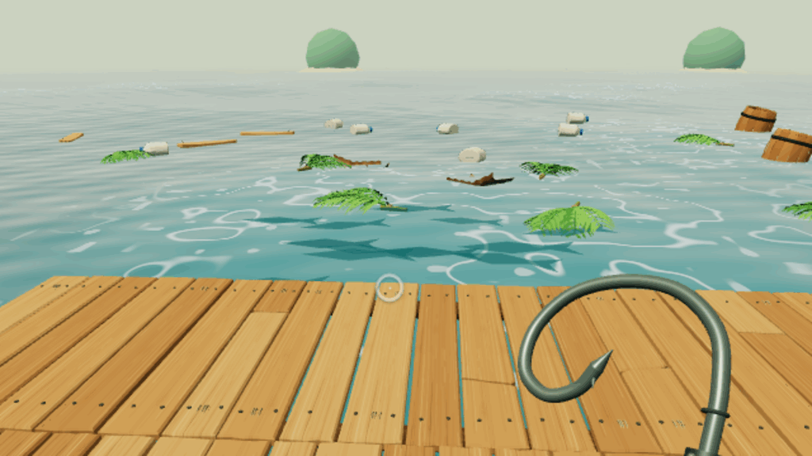
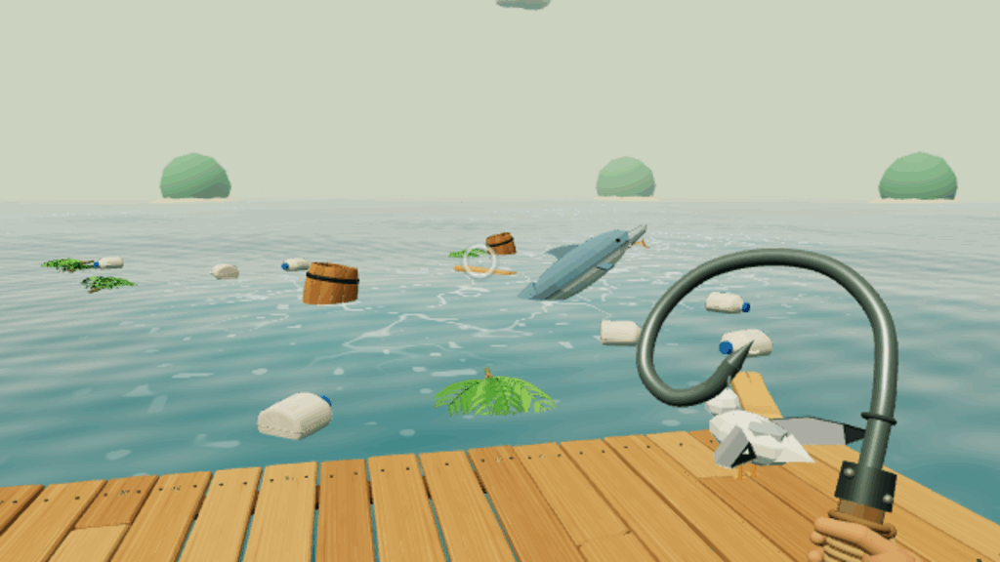
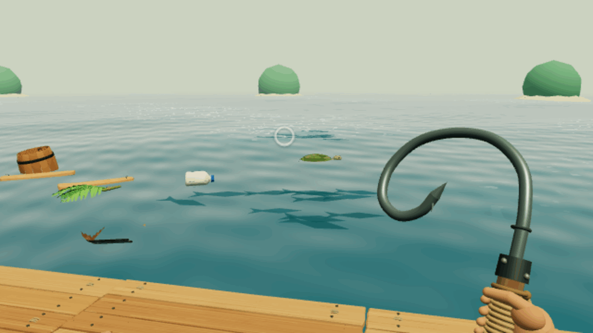

# Wildlife

Seagulls that circle and land on the raft, fish schools you can see just under the surface, and now and then a dolphin or a sea turtle swimming by. Everything is scenery. Nothing bites, steals, or breaks anything.

## What Raft does

raft.wiki.gg could not be reached. An earlier pass got HTTP 401 (Cloudflare). This pass's WebFetch of `/wiki/Seagull` failed DNS because the host is outside this session's allowed network domains. The facts below come from the older official fandom wiki (through search snippets), Wikipedia, and guides.

| Creature | Raft behaviour | Source |
|---|---|---|
| Shark ("Bruce") | Always circles the raft, attacks swimmers and bites raft tiles. | https://en.wikipedia.org/wiki/Raft_(video_game) |
| Seagull | Farm pest. Circles, then dives at a crop about every 4 minutes. You have 15 s to stop it, and walking within about 2.25 m scares it off. A scarecrow within 3.5 m pulls the attack onto itself. | https://raft.fandom.com/wiki/Seagulls, https://www.gameskinny.com/tips/raft-how-to-defend-your-crops-from-seagull-attacks/ |
| Fish | You only meet them as catches from a rod. You never see them swim. | https://techraptor.net/gaming/guides/raft-fishing-guide |
| Dolphins, turtles | Not in Raft. Players asked for them on Steam. | https://steamcommunity.com/app/648800/discussions/0/3068621701766650206 |

## Our friendlier version

- **Gulls (3 to 6).** They glide on wide circles 6.5 to 11.5 m above the raft, 7 to 12 m out (further on a big raft). Every 20 to 50 s a gull picks a free perch (a raft tile with no decor, or the top of a `sail`, `crate` or `bench`), glides down, folds its wings, and hops around for 6 to 15 s before leaving. If either player comes within 3 m it takes off early. Gulls never touch items, crops or inventory.
- **Fish schools (2 of 12).** Each school swims a loose loop 0.4 to 1.2 m under the surface, 6 to 18 m out, and shows through the shallow water colour.
- **Friendly circler (one at a time).** This takes the shark's place. Every 90 to 180 s a dolphin (70%) or a turtle (30%) makes one or two slow laps at 9 to 14 m, never closer than 7 m, then leaves.
- Nothing has collision or any gameplay effect.

## As built

Status: implemented in `dist/wildlife.js` (module, plan, debug) and `dist/wildlife-models.js` (merged low-poly
geometries). No game.js, content.js or inventory-state.js edits; no new hooks.

- **Gulls.** White body and head, grey mantle and wings with black, white-spotted tips, orange beak with a red
  spot, orange legs and webbed feet, black eyes (~0.6 m long, 1.4 m span). They bank on their circle and glide
  with bursts of flapping. A visit runs inside a 40 s slot per gull: glide down over 4 s, then perch 6 to 15 s
  with a small hop and turn every 2.3 s, then 4 s to climb back to the circle. 72% of slots have a visit.
  Perches: free tiles (deck y .2), the sail mast top (3.84), a crate lid (1.07) or a bench seat (.69). In
  one slot, gulls take consecutive perch indices from a shared base, so two never share a perch. A gull with
  no free perch (index >= perch count) keeps circling. Perched gulls take the raft's bob and tilt.
- **Perch choice at visit start.** The scheduled perch is used unless another gull already holds it or either
  player stands within 3.5 m of it (horizontal). Then the gull takes the next free index, or skips the visit.
  Both clients see both players and the same latches, so they choose alike. `debug.landGull` also skips
  perches another gull holds. This keeps gulls from landing beside the spawn point and filling the view.
- **Wings near the deck.** The height above the perch drives the wings. Below 0.8 m they are fully folded
  (they open between 0.8 and 1.5 m), the flap amplitude shrinks as they fold, and a downstroke is clamped so
  the tip stays above the deck (`asin((h + 0.24) / 0.68)`). A folded wing swings back along the flank, stands
  on edge with the grey top facing out, sits 9 cm lower at the shoulder and is shortened to 70%, so the black
  tips just cross the tail. The perched hop only twitches the wings.
- **Underwing and legs.** The wing has a second, pale layer 8 mm under the top, so it shows from below even on
  the mirrored left wing. From below only the dim teal ground light reaches it, so its vertex colours are
  boosted above 1 (warm, `x3.0/2.35/2.25`, not clamped by the shader) to read pale. The legs fold back under
  the belly in flight: gull bodies use their own copy of the Lambert material with a 3-line `onBeforeCompile`
  vertex tweak that swings and shrinks leg vertices (`legW = 1`) about the hip by a per-instance `tuck`
  attribute. `tuck = 1 - fold` in the air and 0 when perched, so the legs come down as the gull lands. This is
  one extra program compiled at startup, with no extra draw calls.
- **Perch latch.** When a visit begins, the module copies that perch as `{key, x, y, z}` and keeps it for the
  whole visit, so a perch-list rebuild (a tile or decor change shifts the indices) never moves a gull. If the
  latched key disappears from the new list, or its height changes (a crate or palm placed on it), the gull
  takes off from where it is, like a scare. A gull that sees no perch at its visit start skips that visit.
- **Scare.** When either player is within 3 m (horizontal, and within 3 m vertically) of a perched gull,
  that gull leaves early. The local player is `ctx.physics`, the friend is `ctx.other` (`{x, y, z}`; a null `y`
  counts as `ctx.deckY() + 1.6`). Both clients see both poses, so they agree on the scare without sending
  anything. A scare during the glide down also works and turns the gull back up from its current height.
  A gull spooked by a player swerves up to 5 m away from that player and 1.5 m up (`sin` bump over the
  climb, heading follows the bumped path), so it never flies through the camera.
- **Big rafts.** `raftExtent(tiles)` = max |tile coord| * 2 + 1 (shared tiles, so both clients agree). Each
  path's base radius is pushed out so its closest point stays past the edge: the gull sky circle by
  `ext + 2.5`, fish schools by `ext + 4`, the circler by `ext + 5`. The starter 3x3 raft (ext 3) is unchanged.
- **Fish.** Two schools of 12 dark fish silhouettes (one on `low`), ~0.7 m long (1.3x the 0.55 m model) at
  opacity .6, so they read beyond 6 m without stacking into dark blotches. The ocean shader is opaque, so fish can't
  be drawn below it: each fish is a flat, transparent silhouette laid 3.5 cm over the CPU wave height
  (`ocean.getHeight` per fish, 24 calls a frame). Its plan depth (-1.15 to -0.45 m) tints it toward the
  water colour through `instanceColor`, so deeper fish look fainter. Tail wiggle is a fast yaw (off on `low`).
- **Circler.** A 180 s window holds at most one visit: dolphin 70% (r 10 to 14 m, 2.6 m/s, 1 or 2 laps) or
  turtle 30% (r 9 to 12 m, 0.9 m/s, 1 lap), arriving and leaving over 10 s from 25 m further out. It is
  present ~40% of the time and never closer than 7 m. The dolphin moves in a 3 s rhythm: a 1 s leap out
  of the water, then a 2 s porpoising roll where the head and rounded back break the surface (nose up rising,
  nose down going under, pitch eased into and out of each leap). Its dorsal fin is the same blue-grey as the
  back and falcate (curved back, hooked trailing edge), so it never reads as a shark's straight dark fin. The
  turtle is 1.3 m from head to tail (model x0.73) and floats low: the waterline cuts mid-shell, with the head
  raised just clear. Its faceted shell uses four muted olive greens like scutes.
- **Materials.** One `MeshLambertMaterial({vertexColors, flatShading, DoubleSide})` shared by wings, dolphin
  and turtle, a copy of it with the leg tuck for gull bodies, and one `MeshBasicMaterial` (transparent,
  opacity .6, no depth write) for fish.

## Module shape (content registry)

`dist/wildlife.js` exports `createWildlife(ctx)`, which returns a module for `dist/content.js`. It needs no new game.js hook.

| Hook | Wildlife does |
|---|---|
| `name` | `'wildlife'` |
| `update(dt)` | Advances the clock, plans each creature, writes the instance matrices. No allocations. |
| `serialize()` | Solo or guest: `undefined` (nothing saved). Host: one reused `{t}` object (see Co-op clock). |
| `load(data, from)` | `'net'`: read the host clock. `'save'` and `'restore'`: reset the offset to 0. Garbage is ignored, and it never throws. |
| `debug` | QA helpers, below. |
| `dispose()` | Removes the group, disposes every geometry and material. Later `update` calls do nothing (no rebuild). |

`action`, `interact`, `prompt`, `craftLocked`, `decorModel` and `afterMove` are unused. Meshes are built on the first `update`, when `ctx.scene` and `ctx.ocean` exist, and go into one `T.Group`. The local player is `ctx.physics` (`x, y, z`). Perched gulls take the bob and tilt of `ctx.raft`.

## Co-op clock

Both clients evaluate the same closed-form plan from a clock `t`, plus `world.tiles` and `world.decor`, which the state message already syncs. `Date.now()` is out because machine clocks can disagree by seconds. `ctx.elapsed` is per-client, so it is not shared on its own.

**Decision: use the host's elapsed time.**

- Host: `serialize()` sets `net.t = Math.round(now() * 10) / 10` (its own clock, including any `setTime` offset) on one preallocated object and returns it. That is about 12 bytes per state message. It also lands in `world.ext.wildlife` on host saves, which is harmless because `load(_, 'save')` ignores it.
- Guest, `load(d, 'net')`: if `Number.isFinite(d?.t)`, compute `off = d.t - ctx.elapsed` and store it as the target offset. On the first message, or if `|off - offset| > 10` (the host reloaded), `offset` snaps to it. Otherwise `update(dt)` eases `offset` toward the target at 0.5 s per second or less (dt capped at 0.1 s a step). Drift is normal, because each client's `elapsed` clamps its frame dt at 0.05 s, so a slow machine falls behind. Easing keeps the clock moving forward at 0.5x to 1.5x speed, so nothing pops.
- Clock: `t = ctx.elapsed + offset`. Solo and host keep `offset = 0`. `load(_, 'restore')` (the guest back on their own raft) resets the offset and the synced flag.
- Scares are not sent. Each client checks both players against the perches, so both see the same gull leave (to within a frame or two).

## Lean rendering

Everything is created once and cached. Per-frame work writes only to scratch `Matrix4`, `Vector3`, `Quaternion` and `Euler` objects and sets `instanceMatrix.needsUpdate`. Hidden instances are trimmed with `mesh.count` (gulls and fish fill their first instances), so they are not drawn or computed. `update` calls `raft.updateWorldMatrix(true, false)` once (the raft and its parents, not its deck children), so perched gulls use this frame's bob and tilt.

| Mesh | Geometry | Material | Instances |
|---|---|---|---|
| `gullBody` InstancedMesh | merged body, mantle, head, beak, eyes, tail, legs and feet, 424 tris, vertex colours, `legW` per vertex, instanced `tuck` | own `MeshLambertMaterial({vertexColors:true, flatShading:true, side:DoubleSide})` with the leg-tuck vertex tweak | 6 |
| `gullWing` InstancedMesh | 3-panel wing with a black tip and white mirror spot on top, pale boosted underside layer, 11 tris, pivot at the shoulder | shared `MeshLambertMaterial({vertexColors:true, flatShading:true, side:DoubleSide})` | 12 (2 per gull; the left wing is mirrored with `scale.x = -1`). The flap is a roll in the matrix; folding swings, twists and shortens it. |
| `fish` InstancedMesh | 8-tri diamond with a tail notch | `MeshBasicMaterial`, `transparent`, opacity .6, `depthWrite:false`, depth tint through `instanceColor` | 24. Laid on the wave surface (the ocean is opaque). The tail wiggle is a yaw in the matrix. |
| `dolphin` Mesh | merged body, tail stock, rostrum, falcate dorsal fin, flukes, pectoral fins, eyes | shared Lambert | 1 |
| `turtle` Mesh | merged faceted shell, rim, plastron, neck, head, eyes, 4 flippers, tail, 537 tris (scaled 0.73x, 1.3 m) | shared Lambert | 1 (only one circler is visible at a time) |

**Draw calls: 4** (gull bodies, gull wings, fish, the visible circler). There are no new lights. The one shader edit (the gull leg tuck) is fixed at startup, so nothing recompiles at runtime. Wildlife casts no shadows. The instanced meshes use `frustumCulled = false`, because their bounds would otherwise need per-frame updates.

**Graphics.** `ctx.options.graphics` is read every frame with a string compare, so changes apply live.

| Setting | Gulls | Fish | Circler |
|---|---|---|---|
| `low` | 3 | 1 school (12), no tail wiggle | yes |
| `medium` | 5 | 2 schools (24) | yes |
| `high` | 6 | 2 schools (24) | yes |

The circler takes one `ctx.ocean.getHeight` sample per frame. Fish take one each (24, or 12 on `low`), because a flat silhouette at the mean level would sink under the crests.

## Pure plan (exported for tests, no THREE)

```js
export const WILDLIFE_SEED = 0x5eaf00d;
export function mulberry32(a)                       // -> () => [0,1)
export function perchesFrom(tiles, decor)           // -> [{x,y,z,key}] sorted by key: free tiles + sail/crate/bench tops
export function raftExtent(tiles)                   // -> max |tile coord| * 2 + 1, or 0 with no tiles
export function layoutHash(tiles, decor)            // -> int32 hash of tile x,z and decor type,x,z (no allocation)
export function gullVisit(seed, i, slot, n, v)      // fills v {on, start, stay, perch, yaw} for gull i's slot
export function gullPlan(seed, i, t, perches, out, scareAt = -Infinity, visit = null, perch = undefined, ext = 0)
                                                    // perch: omitted = perches[visit.perch], an {x,y,z} (the latched perch), or null = none
                                                    // fills out {state:'circle'|'descend'|'perched'|'leave', x,y,z, yaw,pitch,roll, flap,fold, blend, sx,sy,sz, px,py,pz, perch}
export function schoolCenter(seed, i, t, out, ext = 0) // fills out {x, y, z, heading}
export function fishOffset(seed, i, j, out)         // fills out {side, along, ph, size, depth} for fish j of school i
export function circlerAt(seed, t, out, force = null, ext = 0) // fills out {kind:null|'dolphin'|'turtle', x,y (above water),z, heading, pitch, roll}
```

Each function fills an `out` object, so `update` reuses scratch objects. The PRNG is a stateless mulberry32 step (`rnd(s, n)` is the nth output of `mulberry32(s)`), keyed per window as `seed ^ imul(i+1, 0x9e37) ^ imul(slot+1, k)` with `slot = floor(t / SLOT)`, so each result depends only on its inputs and nothing allocates. `perchesFrom` reruns only when the layout really changes. A new `world.tiles` or `world.decor` reference or length is checked against `layoutHash(tiles, decor)`, an allocation-free FNV-style hash of tile `x, z` and decor `type, x, z`. The guest gets fresh arrays from `cleanWorld` with every state message (~8 Hz), and without the hash it rebuilt the perch list each time. A real change rebuilds the list, a key map and `raftExtent` (allocation is fine there, it is not per frame).

## Debug (`raftDebug.content.wildlife`)

| Helper | Effect |
|---|---|
| `snapshot()` | `{t, offset, perches, gulls:[{x,y,z,state}], schools:[{x,z}], circler:{kind,x,z}\|null, built, ext, rebuilds}` (`rebuilds` counts perch-list rebuilds) |
| `summonCircler(kind)` | `'dolphin'` or `'turtle'`. That circler is on its circle now, in the direction the camera faces (radius clamped to 9 to 14 m). It swims one lap and leaves, then the schedule resumes. |
| `landGull(i = 0, {instant, perch, stay, yaw, scare})` | Gull `i` perches for `stay` (15) s on the perch nearest the camera's look point (or perch index `perch`). `instant` skips the glide down. Forced gulls ignore the player unless `scare: true`. |
| `schoolHere(i = 0, dist = 5)` | Pins school `i` `dist` m ahead of the camera (pushed out past the deck edge), broadside to the view, until `release()`. |
| `release()` | Clears all overrides. |
| `setTime(t)` | Sets the offset so the clock reads `t`, for repeatable shots. |
| `perches` | Copy of the current perch list. |
| `setVisible(on)`, `renderCalls()` | Hide or show the wildlife group, and read `renderer.info.render.calls`, for draw-call checks. |

Overrides are local and are never serialized.

## How to verify

1. `npm test`: `tests/wildlife.test.mjs` covers determinism, smooth paths, perch rules, scare (also mid-glide),
   fish depth and range, circler distance and dolphin share, big-raft clearance, `layoutHash` and the no-rebuild
   rule, and the co-op clock (load garbage, host/guest sync, slew vs snap, host sends `now()`). With real three
   and a stub scene it also checks: a smoke run of 300 updates (finite instance matrices, `count` trimming,
   `dispose` empties the scene), the friend's pose scaring a gull, and a perched gull that does not move when the
   perch list shifts and takes off smoothly when its own perch is covered.
2. Play solo and wait about 10 s of game time: gulls drop onto the deck. Walk up to one and it flies off.
   Look out to sea for dark fish shapes. Within a few minutes a dolphin or turtle swims a lap.
3. In the console: `const w = raftDebug.content.wildlife; w.landGull(0, {instant:true}); w.schoolHere(0);
   w.summonCircler('dolphin')`, then `w.summonCircler('turtle')`, and `w.release()` afterwards.
4. Draw calls: `w.renderCalls()`, then `w.setVisible(false)`, wait a frame, and `w.renderCalls()` again.
5. Co-op: host and guest should see the same gulls on the same tiles (the guest's clock follows `ext.wildlife.t`).

Screenshots (headless Chromium, software GL, taken with `landGull`, `schoolHere` and `summonCircler`). The
gull shot is the full view at 1024 px. The fish, dolphin and turtle shots are 2x crops of the centre of the view:

| | |
|---|---|
|  |  |
|  |  |

**Measured draw calls** (`renderer.info.render.calls`, solo spawn, medium graphics, no circler on screen):
317 with the wildlife group hidden and 320 with it shown, so +3 (gull bodies, gull wings, fish). A visible
dolphin or turtle adds 1, for at most +4, as designed. Floating debris makes the total vary by about 1 between
frames. The fish material sets `forceSinglePass`, because three.js otherwise draws transparent DoubleSide
meshes twice (an earlier build measured +4 with no circler for that reason). Nothing casts shadows.

## Save format

Nothing is saved. In solo, `serialize()` returns `undefined`, so `world.ext` gets no `wildlife` key. Host saves may carry `{t}`, which loading ignores. Old saves load unchanged.

## Test plan (`tests/wildlife.test.mjs`)

Schedule determinism:
- `gullPlan`, `schoolCenter` and `circlerAt` give deep-equal output for equal inputs, across repeat calls and fresh `out` objects. A different seed changes at least one of 50 sampled `t`.
- Sampled at 10 Hz over 10 min, positions move less than 2 m per step, except across state edges. Every gull spends time in both `circle` and `perched`. Gull `y >= 0`, and fish `y` stays in [-1.2, -0.4].
- `circlerAt` is null most of the time. When present, `hypot(x, z) >= 7`. Over 2,000 windows the dolphin share is 0.70 +/- 0.05.
- Host and guest agree: after `load({t}, 'net')`, the guest clock equals the host time, so plans match.

Perch choice:
- `perchesFrom` drops tiles that hold decor, except sail, crate and bench, which give a raised perch. Shuffled input gives identical output, and empty input gives `[]`.
- A perched gull sits exactly on a perch, and two gulls never share a perch in the same window.
- After a tile is removed, the next window picks only from the new list. With no perches, gulls keep circling.
- A gull mid-visit keeps its latched perch through a rebuild; it leaves when that perch is gone.
- Gulls never perch within 3.5 m of a player, a spooked gull ends up away from the player and higher, and
  `landGull` never stacks two gulls on one perch.
- Wings are folded below 0.8 m above the perch and the wing tip never dips under the deck.
- The dolphin leaps every 3 s cycle and is never under for more than 2 s.

Module (stub ctx, no scene):
- `load(undefined)`, `load('junk')`, `load({t:NaN}, 'net')` and `load({t:1e308}, 'net')` never throw.
- Solo `serialize()` returns `undefined`, and host `serialize()` returns the same object every call.
- A gap over 10 s snaps the offset. Smaller drift eases at 0.5 s/s.
- Fresh arrays with the same layout do not rebuild perches; a decor change does.

Headless: screenshot scripts call `setTime`, `landGull`, `schoolHere` and `summonCircler`, then check that `renderer.info.render.calls` grows by at most 4.
