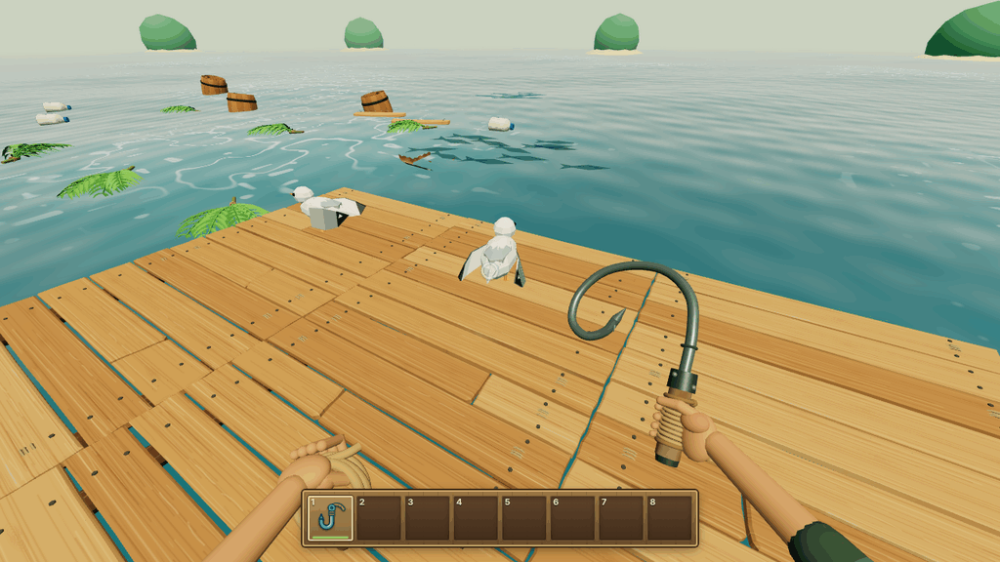

# Wildlife

Seagulls that circle and land on the raft, fish schools you can see just under the surface, and now and then a dolphin or a sea turtle swimming by. Everything is scenery. Nothing bites, steals, or breaks anything.

## What Raft does

raft.wiki.gg could not be reached. An earlier pass got HTTP 401 (Cloudflare). This pass's WebFetch of `/wiki/Seagull` failed DNS because the host is outside this session's allowed network domains. The facts below come from the older official fandom wiki (through search snippets), Wikipedia, and guides.

| Creature | Raft behaviour | Source |
|---|---|---|
| Shark ("Bruce") | Always circles the raft, attacks swimmers and bites raft tiles. | https://en.wikipedia.org/wiki/Raft_(video_game) |
| Seagull | Farm pest. Circles, then dives at a crop about every 4 minutes. You have 15 s to stop it, and walking within about 2.25 m scares it off. A scarecrow within 3.5 m pulls the attack onto itself. | https://raft.fandom.com/wiki/Seagulls, https://www.gameskinny.com/tips/raft-how-to-defend-your-crops-from-seagull-attacks/ |
| Fish | You only meet them as catches from a rod. You never see them swim. | https://techraptor.net/gaming/guides/raft-fishing-guide |
| Dolphins, turtles | Not in Raft. Players asked for them on Steam. | https://steamcommunity.com/app/648800/discussions/0/3068621701766650206 |

## Our friendlier version

- **Gulls (3 to 6).** They glide on wide circles 6.5 to 11.5 m above the raft, 7 to 12 m out. Every 20 to 50 s a gull picks a free perch (a raft tile with no decor, or the top of a `sail`, `crate` or `bench`), glides down, folds its wings, and hops around for 6 to 15 s before leaving. If the local player comes within 2.25 m it takes off early. Gulls never touch items, crops or inventory.
- **Fish schools (2 of 12).** Each school swims a loose loop 0.4 to 1.2 m under the surface, 6 to 18 m out, and shows through the shallow water colour.
- **Friendly circler (one at a time).** This takes the shark's place. Every 90 to 180 s a dolphin (70%) or a turtle (30%) makes one or two slow laps at 9 to 14 m, never closer than 7 m, then leaves.
- Nothing has collision or any gameplay effect.

## As built

Status: implemented in `dist/wildlife.js` (module, plan, debug) and `dist/wildlife-models.js` (merged low-poly
geometries). No game.js, content.js or inventory-state.js edits; no new hooks.



- **Gulls.** White body and head, grey mantle and wings with black, white-spotted tips, orange beak with a red
  spot, orange legs and webbed feet, black eyes (~0.6 m long, 1.4 m span). They bank on their circle and glide
  with bursts of flapping. A visit runs inside a 40 s slot per gull: glide down over 4 s, then perch 6 to 15 s
  with a small hop and turn every 2.3 s, then 4 s to climb back to the circle. 72% of slots have a visit.
  Perches: free tiles (deck y .2), the sail mast top (3.84), a crate lid (1.07) or a bench seat (.69). In
  one slot, gulls take consecutive perch indices from a shared base, so two never share a perch. A gull with
  no free perch (index >= perch count) keeps circling. Perched gulls take the raft's bob and tilt.
- **Scare.** When the local player is within 2.25 m (horizontal, and within 3 m vertically) of a perched gull,
  that gull leaves early. This is local only (`scareAt[i]`, kept for the current slot).
- **Fish.** Two schools of 12 dark fish silhouettes (one on `low`). The ocean shader is opaque, so fish can't
  be drawn below it: each fish is a flat, transparent silhouette laid 3.5 cm over the CPU wave height
  (`ocean.getHeight` per fish, 24 calls a frame). Its plan depth (-1.15 to -0.45 m) tints it toward the
  water colour through `instanceColor`, so deeper fish look fainter. Tail wiggle is a fast yaw (off on `low`).
- **Circler.** A 180 s window holds at most one visit: dolphin 70% (r 10 to 14 m, 2.6 m/s, 1 or 2 laps) or
  turtle 30% (r 9 to 12 m, 0.9 m/s, 1 lap), arriving and leaving over 10 s from 25 m further out. It is
  present ~40% of the time and never closer than 7 m. The dolphin cruises with its back and fin showing and
  leaps in an arc every 5.2 s. The 2.1 m turtle paddles at the surface with a gentle roll. The faceted shell
  uses four greens like scutes.
- **Materials.** One `MeshLambertMaterial({vertexColors, flatShading, DoubleSide})` shared by gulls, wings,
  dolphin and turtle. One `MeshBasicMaterial` (transparent, opacity .7, no depth write) for fish.

## Module shape (content registry)

`dist/wildlife.js` exports `createWildlife(ctx)`, which returns a module for `dist/content.js`. It needs no new game.js hook.

| Hook | Wildlife does |
|---|---|
| `name` | `'wildlife'` |
| `update(dt)` | Advances the clock, plans each creature, writes the instance matrices. No allocations. |
| `serialize()` | Solo or guest: `undefined` (nothing saved). Host: one reused `{t}` object (see Co-op clock). |
| `load(data, from)` | `'net'`: read the host clock. `'save'` and `'restore'`: reset the offset to 0. Garbage is ignored, and it never throws. |
| `debug` | QA helpers, below. |
| `dispose()` | Removes the group, disposes every geometry and material. |

`action`, `interact`, `prompt`, `craftLocked`, `decorModel` and `afterMove` are unused. Meshes are built on the first `update`, when `ctx.scene` and `ctx.ocean` exist, and go into one `T.Group`. The local player is `ctx.physics` (`x, y, z`). Perched gulls take the bob and tilt of `ctx.raft`.

## Co-op clock

Both clients evaluate the same closed-form plan from a clock `t`, plus `world.tiles` and `world.decor`, which the state message already syncs. `Date.now()` is out because machine clocks can disagree by seconds. `ctx.elapsed` is per-client, so it is not shared on its own.

**Decision: use the host's elapsed time.**

- Host: `serialize()` sets `net.t = Math.round(ctx.elapsed * 10) / 10` on one preallocated object and returns it. That is about 12 bytes per state message. It also lands in `world.ext.wildlife` on host saves, which is harmless because `load(_, 'save')` ignores it.
- Guest, `load(d, 'net')`: if `Number.isFinite(d?.t)`, compute `off = d.t - ctx.elapsed`. On the first message, or if `|off - offset| > 2`, set `offset = off`. Small drift is left alone, so nothing jitters at 8 Hz. A big jump (the host reloaded) snaps.
- Clock: `t = ctx.elapsed + offset`. Solo and host keep `offset = 0`. `load(_, 'restore')` (the guest back on their own raft) resets the offset and the synced flag.
- The scare reaction stays local (`scaredUntil[i]`). A gull you spook leaves on your screen only, at no network cost.

## Lean rendering

Everything is created once and cached. Per-frame work writes only to scratch `Matrix4`, `Vector3`, `Quaternion` and `Euler` objects and sets `instanceMatrix.needsUpdate`. Hidden instances get a zero-scale matrix, and `count` stays at the maximum.

| Mesh | Geometry | Material | Instances |
|---|---|---|---|
| `gullBody` InstancedMesh | merged body, mantle, head, beak, eyes, tail, legs and feet, 424 tris, vertex colours | shared `MeshLambertMaterial({vertexColors:true, flatShading:true, side:DoubleSide})` | 6 |
| `gullWing` InstancedMesh | 3-panel wing with a black tip and white mirror spot, 6 tris, pivot at the shoulder | same material | 12 (2 per gull; the left wing is mirrored with `scale.x = -1`). The flap is a roll in the matrix, folded when perched. |
| `fish` InstancedMesh | 8-tri diamond with a tail notch | `MeshBasicMaterial`, `transparent`, opacity .7, `depthWrite:false`, depth tint through `instanceColor` | 24. Laid on the wave surface (the ocean is opaque). The tail wiggle is a yaw in the matrix. |
| `dolphin` Mesh | merged body, tail stock, rostrum, dorsal fin, flukes, pectoral fins, eyes, 479 tris | shared Lambert | 1 |
| `turtle` Mesh | merged faceted shell, rim, plastron, neck, head, eyes, 4 flippers, tail, 537 tris (scaled 1.5x) | shared Lambert | 1 (only one circler is visible at a time) |

**Draw calls: 4** (gull bodies, gull wings, fish, the visible circler). There are no new lights and no shader edits, so nothing recompiles. Wildlife casts no shadows. The instanced meshes use `frustumCulled = false`, because their bounds would otherwise need per-frame updates.

**Graphics.** `ctx.options.graphics` is read every frame with a string compare, so changes apply live.

| Setting | Gulls | Fish | Circler |
|---|---|---|---|
| `low` | 3 | 1 school (12), no tail wiggle | yes |
| `medium` | 5 | 2 schools (24) | yes |
| `high` | 6 | 2 schools (24) | yes |

The circler takes one `ctx.ocean.getHeight` sample per frame. Fish take one each (24, or 12 on `low`), because a flat silhouette at the mean level would sink under the crests.

## Pure plan (exported for tests, no THREE)

```js
export const WILDLIFE_SEED = 0x5eaf00d;
export function mulberry32(a)                       // -> () => [0,1)
export function perchesFrom(tiles, decor)           // -> [{x,y,z,key}] sorted by key: free tiles + sail/crate/bench tops
export function gullVisit(seed, i, slot, n, v)      // fills v {on, start, stay, perch, yaw} for gull i's slot
export function gullPlan(seed, i, t, perches, out, scareAt = -1, visit = null)
                                                    // fills out {state:'circle'|'descend'|'perched'|'leave', x,y,z, yaw,pitch,roll, flap,fold, blend, sx,sy,sz, px,py,pz, perch}
export function schoolCenter(seed, i, t, out)       // fills out {x, z, heading}
export function fishOffset(seed, i, j, out)         // fills out {side, along, ph, size, depth} for fish j of school i
export function circlerAt(seed, t, out, force = null) // fills out {kind:null|'dolphin'|'turtle', x,y (above water),z, heading, pitch, roll}
```

Each function fills an `out` object, so `update` reuses scratch objects. The PRNG is a stateless mulberry32 step (`rnd(s, n)` is the nth output of `mulberry32(s)`), keyed per window as `seed ^ imul(i+1, 0x9e37) ^ imul(slot+1, k)` with `slot = floor(t / SLOT)`, so each result depends only on its inputs and nothing allocates. `perchesFrom` reruns only when the `world.tiles` or `world.decor` reference or length changes.

## Debug (`raftDebug.content.wildlife`)

| Helper | Effect |
|---|---|
| `snapshot()` | `{t, offset, perches, gulls:[{x,y,z,state}], schools:[{x,z}], circler:{kind,x,z}\|null, built}` |
| `summonCircler(kind)` | `'dolphin'` or `'turtle'`. That circler is on its circle now, in the direction the camera faces (radius clamped to 9 to 14 m). It swims one lap and leaves, then the schedule resumes. |
| `landGull(i = 0, {instant, perch, stay, yaw, scare})` | Gull `i` perches for `stay` (15) s on the perch nearest the camera's look point (or perch index `perch`). `instant` skips the glide down. Forced gulls ignore the player unless `scare: true`. |
| `schoolHere(i = 0, dist = 5)` | Pins school `i` `dist` m ahead of the camera (pushed out past the deck edge), broadside to the view, until `release()`. |
| `release()` | Clears all overrides. |
| `setTime(t)` | Sets the offset so the clock reads `t`, for repeatable shots. |
| `perches` | Copy of the current perch list. |
| `setVisible(on)`, `renderCalls()` | Hide or show the wildlife group, and read `renderer.info.render.calls`, for draw-call checks. |

Overrides are local and are never serialized.

## How to verify

1. `npm test`: `tests/wildlife.test.mjs` covers determinism, smooth paths, perch rules, scare, fish depth and
   range, circler distance and dolphin share, and the co-op clock (load garbage, host/guest sync, snap vs jitter).
2. Play solo and wait about 10 s of game time: gulls drop onto the deck. Walk up to one and it flies off.
   Look out to sea for dark fish shapes. Within a few minutes a dolphin or turtle swims a lap.
3. In the console: `const w = raftDebug.content.wildlife; w.landGull(0, {instant:true}); w.schoolHere(0);
   w.summonCircler('dolphin')`, then `w.summonCircler('turtle')`, and `w.release()` afterwards.
4. Draw calls: `w.renderCalls()`, then `w.setVisible(false)`, wait a frame, and `w.renderCalls()` again.
5. Co-op: host and guest should see the same gulls on the same tiles (the guest's clock follows `ext.wildlife.t`).

Screenshots (headless Chromium, software GL): `docs/cloud/shots/content/wildlife-*.png`.

## Save format

Nothing is saved. In solo, `serialize()` returns `undefined`, so `world.ext` gets no `wildlife` key. Host saves may carry `{t}`, which loading ignores. Old saves load unchanged.

## Test plan (`tests/wildlife.test.mjs`, pure, no THREE)

Schedule determinism:
- `gullPlan`, `schoolCenter` and `circlerAt` give deep-equal output for equal inputs, across repeat calls and fresh `out` objects. A different seed changes at least one of 50 sampled `t`.
- Sampled at 10 Hz over 10 min, positions move less than 2 m per step, except across state edges. Every gull spends time in both `circle` and `perched`. Gull `y >= 0`, and fish `y` stays in [-1.2, -0.4].
- `circlerAt` is null most of the time. When present, `hypot(x, z) >= 7`. Over 2,000 windows the dolphin share is 0.70 +/- 0.05.
- Host and guest agree: after `load({t}, 'net')`, the guest clock equals the host time, so plans match.

Perch choice:
- `perchesFrom` drops tiles that hold decor, except sail, crate and bench, which give a raised perch. Shuffled input gives identical output, and empty input gives `[]`.
- A perched gull sits exactly on a perch, and two gulls never share a perch in the same window.
- After a tile is removed, the next window picks only from the new list. With no perches, gulls keep circling.

Module (stub ctx, no scene):
- `load(undefined)`, `load('junk')`, `load({t:NaN}, 'net')` and `load({t:1e308}, 'net')` never throw.
- Solo `serialize()` returns `undefined`, and host `serialize()` returns the same object every call.
- A big clock jump snaps the offset. A 0.5 s jitter does not.

Headless: screenshot scripts call `setTime`, `landGull`, `schoolHere` and `summonCircler`, then check that `renderer.info.render.calls` grows by at most 4.
