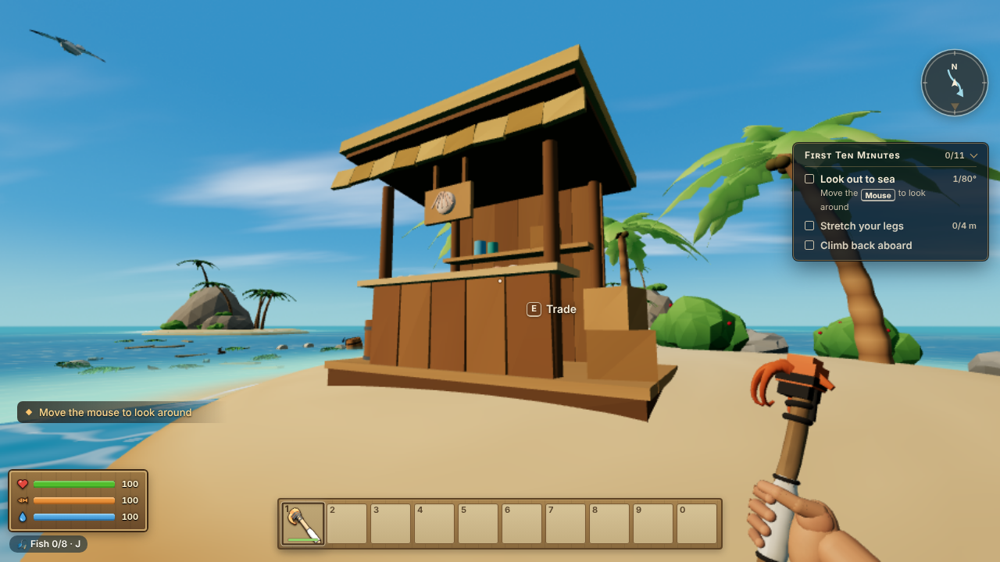
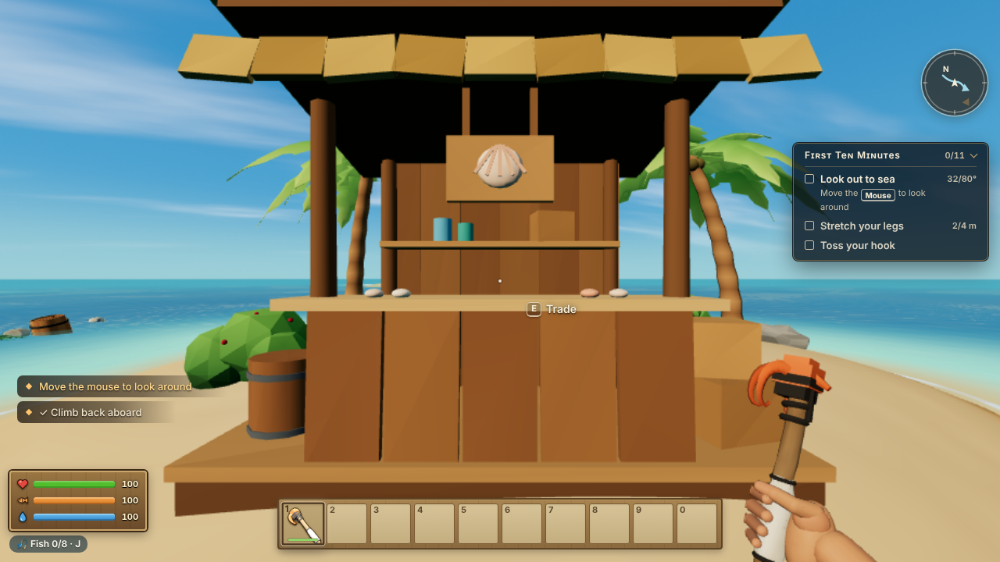
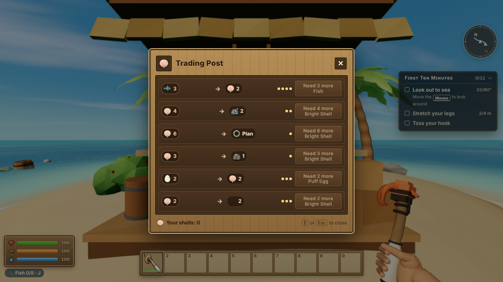
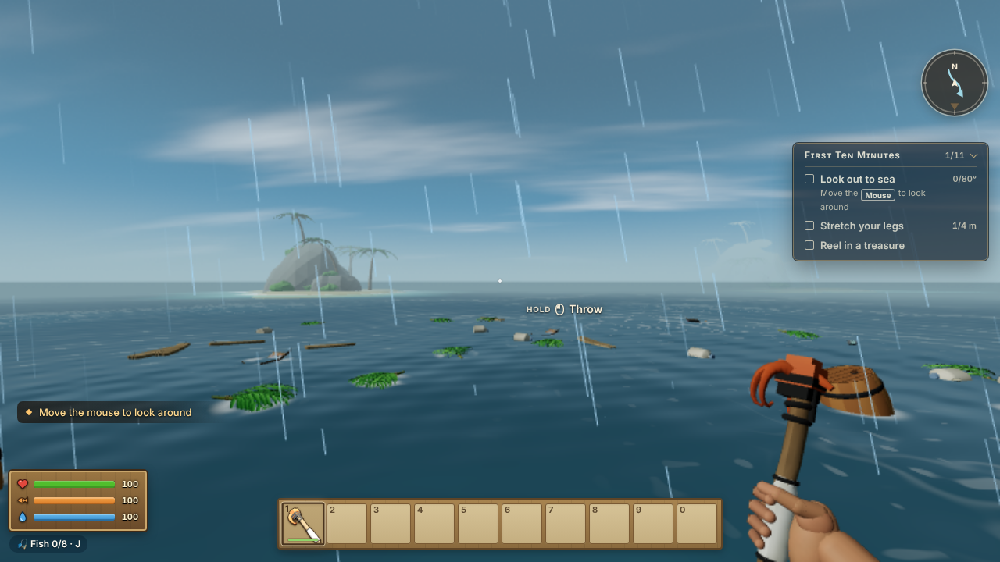

# Player feedback, round 3: camera snap and the trader

Branch claude/raft-feedback-3, built from origin/main 68ccda2 with two plain merge commits:
claude/raft-camera-snap (d3367d1), then claude/raft-trader (fab25f7). Neither merge had a conflict.

Player reports:
- Camera: looking up snaps the view to the top, looking down snaps it to the bottom, and interacting with something snaps it to the bottom.
- Trader: "Pim" is not in real Raft, and he keeps popping up.

## Root causes

### Camera snap
1. `lookFilter.reset()` ran on every blocked frame, from `quiet()` in dist/input.js and from `pauseInput`/`clearInput` in dist/game.js.
   Each reset cancelled the pending drop of the first move after pointer relock. When a panel closed, the browser's warp back to centre
   went straight into pitch. This is the "interacting snaps to bottom" report.
2. A move that arrived before `pointerlockchange` was never dropped.
3. The spike threshold was a raw floor of 400 counts. That is far too high for pitch, which only spans +-1.35 rad, and it ignored sensitivity.
   At 3x sensitivity a 150-count vertical spike moved pitch by 0.92 rad.
4. When a spike was held back, it was added in full if the next move was at least 0.25 of its size.
5. The saved pitch was restored without a clamp.

These were checked and are not causes. Pitch is clamped to +-1.35 rad (77 deg) with Euler order YXZ, so the view cannot flip. No
interaction code sets pitch. There is no look smoothing.

### Trader
The trader was a roaming barge with an otter merchant called Pim. Arrival and cast-off popups ran on timers, so his name kept appearing.
Real Raft has no such character.

## Changes

### Camera snap (commits 022c344, 585df06, b34b9c7, d438c26)
- `createLookFilter` in dist/input-rules.js gains `lock(on)`. `reset()` no longer cancels the drop that follows lock entry.
- The spike check weighs vertical movement 2.5x. The flick ratio is now 0.34, and the size check scales with sensitivity.
- The mousemove handlers in dist/input.js and dist/game.js track pointer lock state.
- The restored pitch is clamped.

### Trader (commits 71e4459, fe3dcc3, d479cbd, 2dc8827)
- Removed the roaming barge, the otter model, the arrival and cast-off popups, their timers, and the name Pim from all player-facing text.
- Added a wooden trading post stall: one draw call, a shell sign and no text. It appears on islands with a layout radius of at least 8,
  which is about a third of them.
- `postFor` places the stall from the island seed, so placement is deterministic. The stall goes on dry, flat sand, clear of trees,
  rocks and treasure. Players are pushed out of it on collision. It shrinks with the island while the island rises or sinks
  (dist/islands.js now reports sink, a 2-line edit).
- Pressing E at the counter opens the Trading Post dialog. All offers, shells, the Glass Float and the Shell Wreath plan are kept.
- The save format is `world.ext.trader` v1 `{r, plans, visit:{seed,stock}}`. Old barge fields are dropped on load, and plans are kept.
- Co-op: the `trader.trade` action and the synced shape are unchanged. A guest derives the post from the island seed.

## Evidence

Produced on this branch at fab25f7, in headless Chrome (/usr/bin/google-chrome, SwiftShader):

- `python shoot.py dist <out>`: all 15 shots taken, `errors: []`. Console shows only SwiftShader driver notices
  (KHR_parallel_shader_compile, GPU stall due to ReadPixels).
- Trading post script (shoot_post.py, island seed 2, R 8.2): post at x -2.09, z 3.33, yaw -0.56. The counter shows the `E Trade` prompt
  beside the crosshair, and `trader.open()` opens the Trading Post dialog. No page errors.

| Shot | File |
| --- | --- |
| Trading post from the beach |  |
| At the counter, with the E Trade prompt |  |
| Trading Post dialog |  |
| Normal play after walking (level pitch, no snap) |  |

Copies of the lane's own shots are in docs/cloud/shots/trader/.

## Tests

- `npm test`: 1413 tests, 1413 pass, 0 fail.
- tests/camera-snap.test.mjs plus tests/trader.test.mjs: 25 of 25 pass. tests/input*.test.mjs: 50 of 50 pass.
- tests/camera-snap.test.mjs run against origin/main's dist: 6 of 8 fail. The test catches the old bug.
- check_settings.py (pointer lock, Esc to pause, FOV, sensitivity saved): passes. It needs a static server on 127.0.0.1:41897 serving
  dist. The script clicks `#solo`, which the title screen no longer shows, so it was run from a scratch copy that clicks the visible
  new-game button instead.
- check_hook.py (same scratch selector fix): fails at the `charge > .9` assert. It fails the same way against origin/main's dist, so
  the failure is pre-existing and not from this round.
- Not run: check_game.py, check_multiplayer.py, check_connection.py, check_live_feed.py, check_survival.py and check_upgrade.py.
  They need a .qa/release or .qa/survival candidate, a signalling relay or a publish step. check_survival.py also asserts an old
  start state (8 tool buttons).

## Risks

### Camera
- A spike during fast looking can still pass through the 4x-average rule.
- At 1x sensitivity, a single vertical flick of about 200 counts or more with no follow-up event is dropped.
- A move above the limit, made from rest, arrives one event late.
- `unadjustedMovement` is not used, because the INPUT-2 test forbids it.

### Trader
- tests/coop-e2e.mjs times out waiting for `#welcomeCrew`, and it does the same on origin/main. Co-op trading is covered only by unit tests.
- The small edit to dist/islands.js may conflict with other fleets.
- "Move a little closer to the counter" is shown as text, in the prompt slot rather than the centre of the screen.
- Pre-existing and seen in the dialog shot: the Palm Seed offer has no visible icon. Palm Seed is a placeholder item with no custom
  drawing, and the dialog uses the flat `iconSVG`, which draws a faint blank tile.
