# Progression: one Raft-style research tree

Branch `claude/raft-progression`. Player report: "a lot of the survival things is just decoration... I don't even think
there's a net catcher... There's no bed... Can't even craft."

Base: the crafting-v2 fleet (`claude/raft-crafting-v2`) had not landed after the 4 hour wait, so this branch is based on
`claude/raft-feedback-all`.

Sources: `docs/loop/raft-progression.md` (Raft 1.0 research) and `docs/loop/function-audit.md` (item by item audit).
The Raft facts come from web search summaries only. The wiki domains (raft.wiki.gg, raft.fandom.com) were blocked, so no
page was read directly. Numbers tagged [S] in the research doc are used as is; the rest are adapted.

## What blocked crafting

- **Two gates, stacked.** `game.js` merged two recipe locks:
  - The items.js progression *hid* every locked items.js recipe except the 3 nearest goals. The Collection Net, grill,
    Research Table, spear and paddle were invisible on a fresh save.
  - The storage module's "Tinker's Desk" locked every recipe outside items.js (bed, purifier, cup, receiver, motor,
    wheel, ...) until you built the desk and studied ingredients. 45 red "Locked: Study it first at a Tinker's Desk" rows.
- **Two research stations** with near-identical jobs: "Research Table" (items.js) and "Tinker's Desk" (content).
  Nothing pointed a new player at the desk.
- **A fresh save had nothing to craft.** Only a hook in the bag: 57 rows, 0 craftable. The Craft button was a greyed
  hammer with no message. Thirst empties in about 15 minutes, while cup and purifier were desk-locked.
- **Why testers missed it.** Both gates grandfathered any save with progress (any collected debris, any decor), so
  every old test save had everything unlocked. Only a truly empty save showed the lock wall.

## The fix

- One research system (`dist/research-tree.js`, `progression.js`, `progression-hooks.js`), like Raft's Research Table:
  place the table, research a material (uses up 1), and a blueprint is learned once its whole material set is
  researched. The research set is the recipe's cost materials unless Raft says otherwise.
- The research action is host-checked: a placed table (or old desk) within reach of that player.
- Locked recipes stay visible with "Research X, Y and Z at the Research Table". Only retired recipes are hidden.
- A greyed Craft button says why ("Missing 2 Palm Leaf", or the lock reason).
- The old desk is an alias: a placed desk opens the Research Table, desk items in a bag load as Research Tables.
- A raft with no stored save (first run, title New Game, in-game New Game) starts with fresh research.

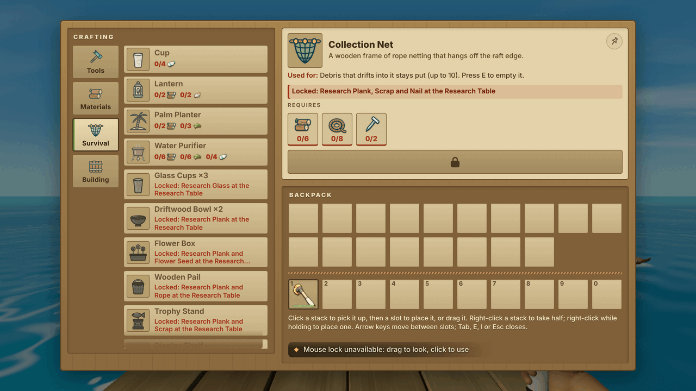
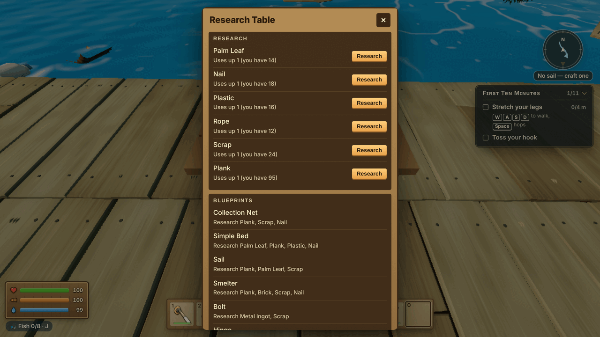

## Stages, ours vs Raft

The start set is 16 recipes: Raft's 12 plus palm planter, lantern and bench (the onboarding chapters use them) and
the shell wreath (an island trading-post plan, still gated by trader.js).

| Stage | Ours | Raft 1.0 |
|---|---|---|
| 0 Start | rope, nail, hook, hammer, Research Table (14 plank, 2 scrap), wooden spear, cup, water purifier, simple grill, paddle, fishing rod, crate; plus palm planter, lantern, bench, shell wreath | rope, hook, hammer, Research Table (14 plank, 2 scrap), spear, cup, simple purifier, simple grill, paddle, fishing rod, small storage |
| 1 Plank, Palm Leaf, Plastic, Scrap, Rope, Nail | Collection Net (research Plank, Scrap, Nail; 6 plank, 8 rope, 2 nail); Simple Bed (Palm Leaf, Plank, Plastic, Nail; 10 leaf, 6 plank, 4 plastic, 3 nail); sail; crop plot; scarecrow; recycler; zipline posts; decor | Simple Collection Net and Simple Bed: same sets and costs [S]. Raft lists the sail under navigation; ours unlocks from these materials |
| 2 Stone, Clay, Sand, Brick | stone axe, cooking pot, paints; Smelter (Plank, Brick, Scrap, Nail; 4 plank, 6 brick, 4 scrap, 6 nail) | Smelter, same set and cost [S] |
| 3 Metal, Copper, Glass, Bolt, Hinge | bolt, hinge, metal hook, metal spear, foundation armor, wind turbine, battery, lights, binoculars | bolt, hinge, metal tools, advanced gear |
| 4 Navigation | receiver (Plastic, Hinge, Copper), antenna (Scrap, Bolt, Copper), little motor (20 plank, 5 metal, 5 rope, 1 copper), steering wheel (10 scrap, 4 metal, 4 rope, 2 bolt) | receiver and antenna need circuit boards; engine and wheel are a Vasagatan blueprint |

Raft's craftable anchors do not exist here: anchoring is still the sail toggle.

## Items removed, renamed, added

- **Retired** (recipe hidden and refused by the host; items still load from saves, placed ones still work and render):
  Tinker's Desk recipe, kiln, glass lantern, line sinker, lightning rod, storm lantern, storm glass, wind pennant, shell
  chime, rope hammock, feather cushion, brick planters, egg lantern, seaglass goggles, tide scraper, course kit, race
  scoreboard, game table, driftboard, spyglass, camera, photo frame, map table, task board, honey glazed fish, beeswax
  candle, gull perch, fish trap.
- **Kept on purpose:** rain barrel (a working water source), shell wreath (trader plan), glass float (trade only).
- **Renamed:** Sorting Tub is now Recycler. The desk item is named Research Table.
- **Retuned to Raft:** Research Table, smelter, little motor, steering wheel.
- **Fixed:** `content-items.js` defined bed, motor, wheel, brush and five paints twice; now once each.
- **Added:** `dist/research-tree.js` (the tree). No new items.

## Net and bed proof

From headless playthroughs of a fresh save (debris given through the debug hook, everything else through the real UI).

- Net: researched Plank, Scrap, Nail, crafted, hung on the raft edge, caught drifting debris into its own storage
  (up to 10, the caught pieces show in the net), `E Empty net (n)` put them in the bag.
- Bed: researched Palm Leaf and Plastic, crafted and placed (sets home), sleeps at night, passing out respawns
  beside it with 25 health, 50 food, 50 water.
- Co-op (`?loopback`): the guest sees the host's nets, empties one with E into the guest's own bag, uses the Research
  Table and sees the same craft locks.
- Old save: an old desk build save keeps what it had; its placed desk opens the Research Table.

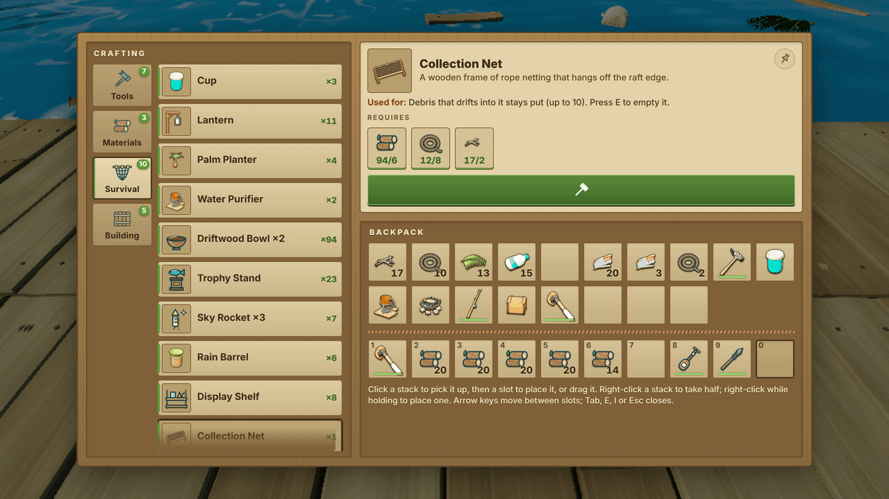
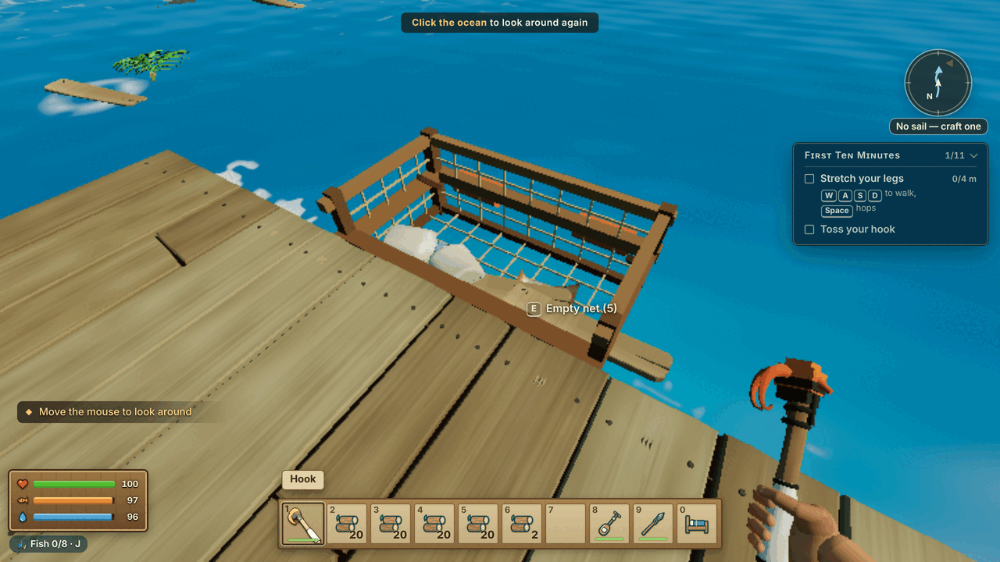
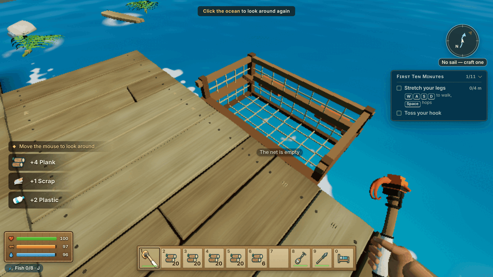
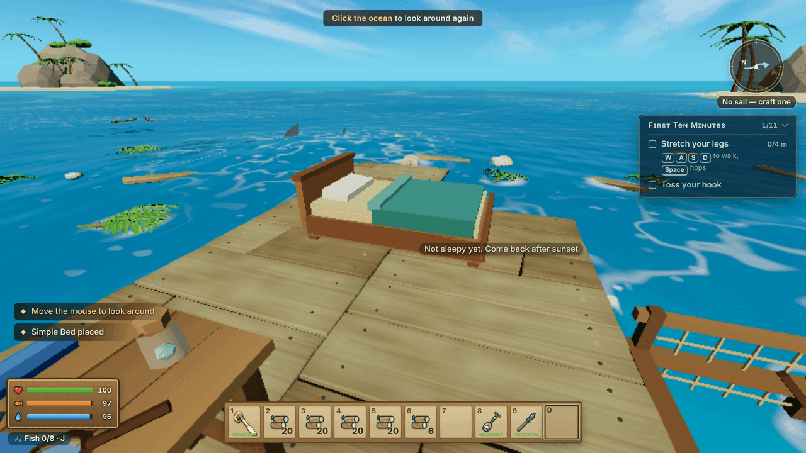
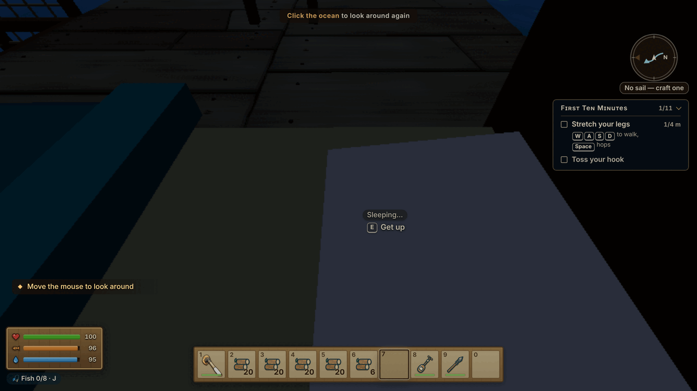
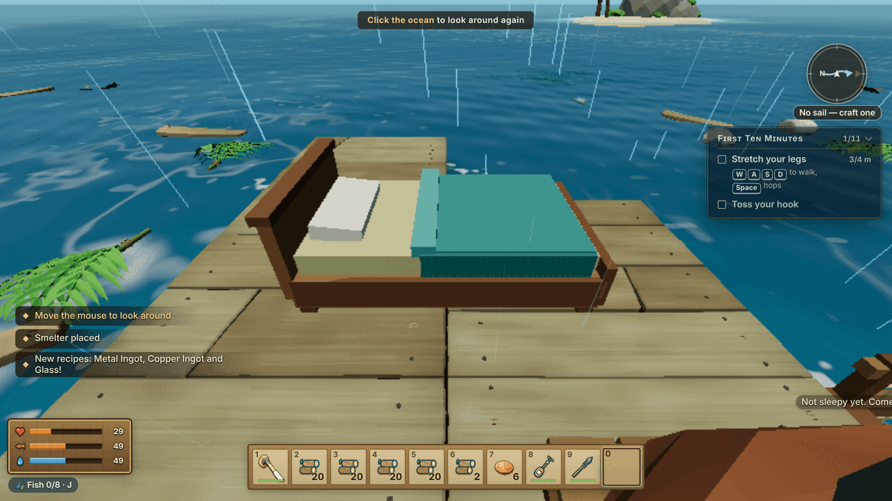
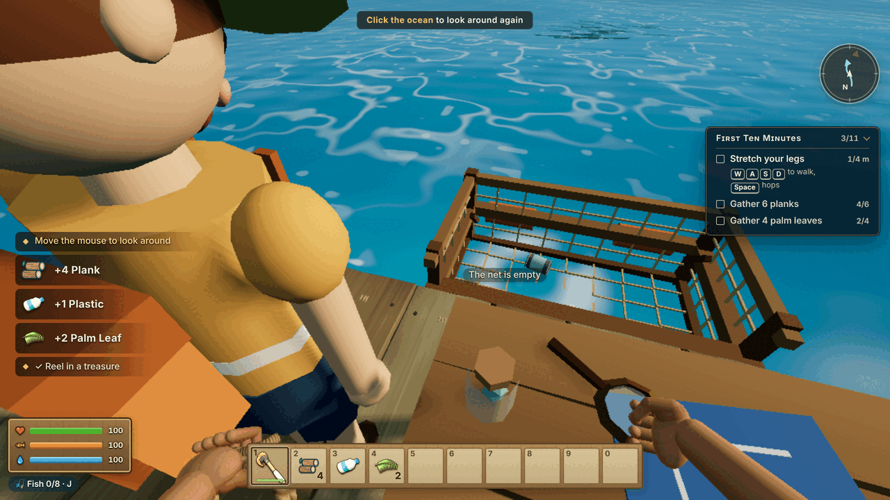
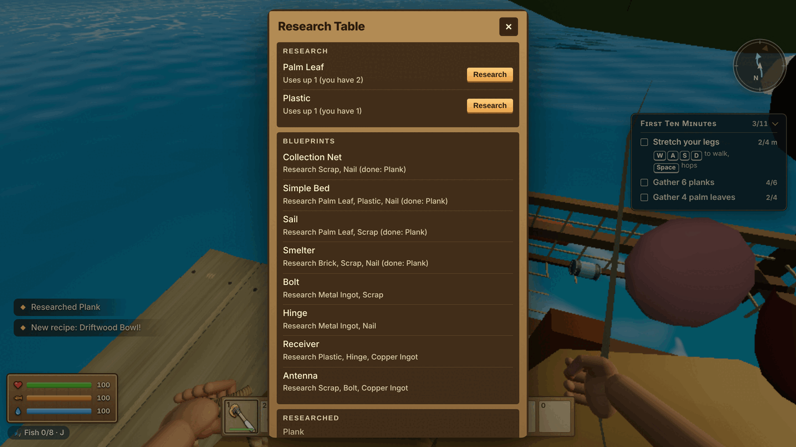
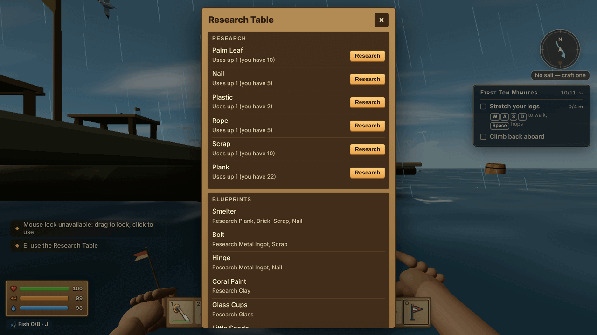

## Old saves

- items.js recipes an old save learned stay learned (`littleRaft.progression.v1`, sticky).
- Content recipes stay learned only if the old desk build offered them to that save: its saved learned list, every
  recipe for a save it grandfathered, plus its starters for an old (v1) slice. items.js ids in that list are ignored.
- Retired recipes are gone even if learned.

## Tests

- `npm test`: 1501 pass, 0 fail. New: `tests/research-tree.test.mjs` (start set craftable from debris, visible locks
  with research hints, net and bed via research with consumption, research reach, desk alias, retired recipes hidden
  but loadable, reachability of every live recipe, old-save adoption, New Game reset, guest mirror).
- `check_*.py`, run against both the base branch and this branch: game, settings, paddle, island_arrival and
  held_items pass on both. hook, survival, connection and multiplayer fail on both at the same lines (stale
  scripts: an 8-button toolbar, `#welcomeCrew`). Not run: check_live_feed (it publishes) and check_upgrade.

## Files touched

- Progression lane: `progression.js`, `progression-hooks.js`, `research-tree.js` (new), `items.js`, `content-items.js`,
  `storage-research.js`; small edits in `game.js`, `content.js`, `live.js` (preload list), `onboarding.js`.
- Crafting-v2-owned: `survival-ui.js`, one line in `paintDetail` (the Craft button reason). Nothing else.
- Follow-ups for the crafting-v2 fleet:
  - `inventory-state.js`: receiver and antenna costs still have no copper, though their research asks for it.
  - `craft-book.js`: texts still say "Sorting Tub" and "tinker's desk".

## Risks

- New Game now resets research (before, research carried over between saves).
- Unlocking the net needs about 15 plank and 5 scrap, roughly 7 minutes of hooking; scrap is the bottleneck.
- The craft panel shows 73 rows on a fresh save, 58 of them locked.
- The receiver and antenna research asks for copper their recipes do not use (see follow-ups).
